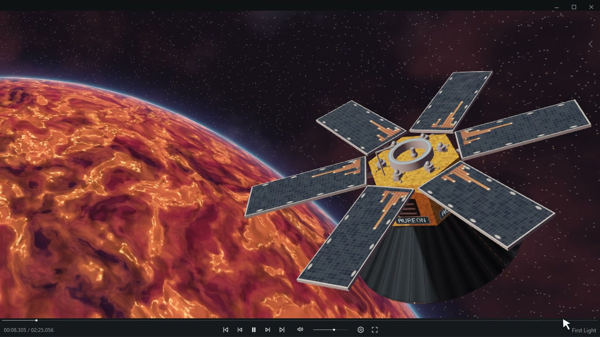
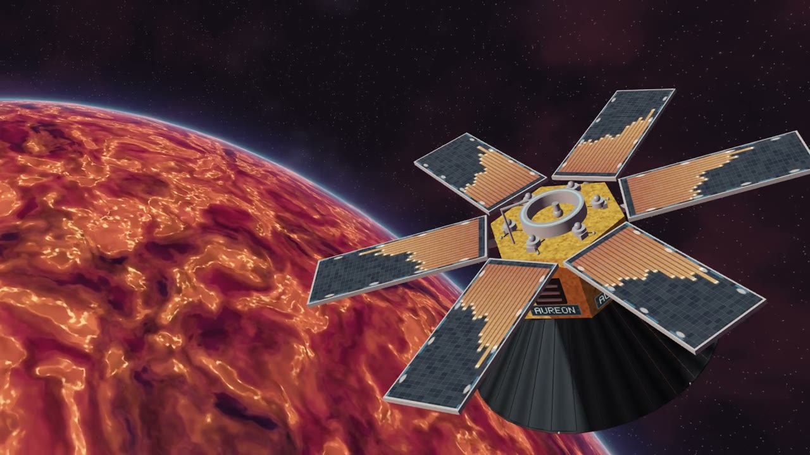
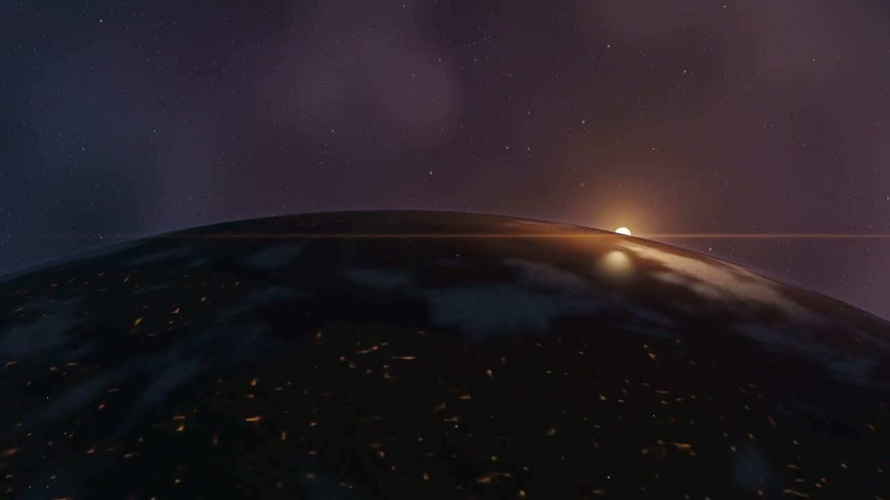
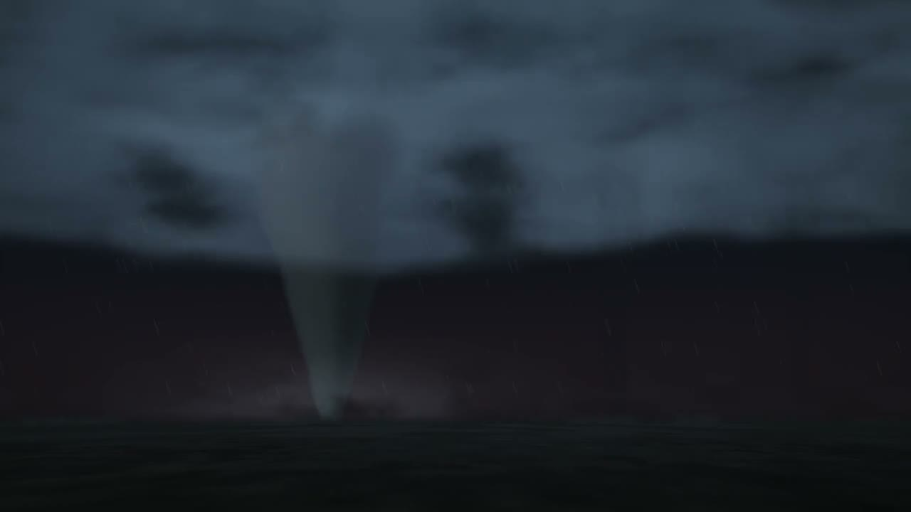
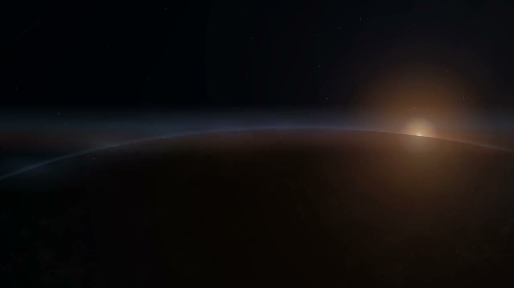
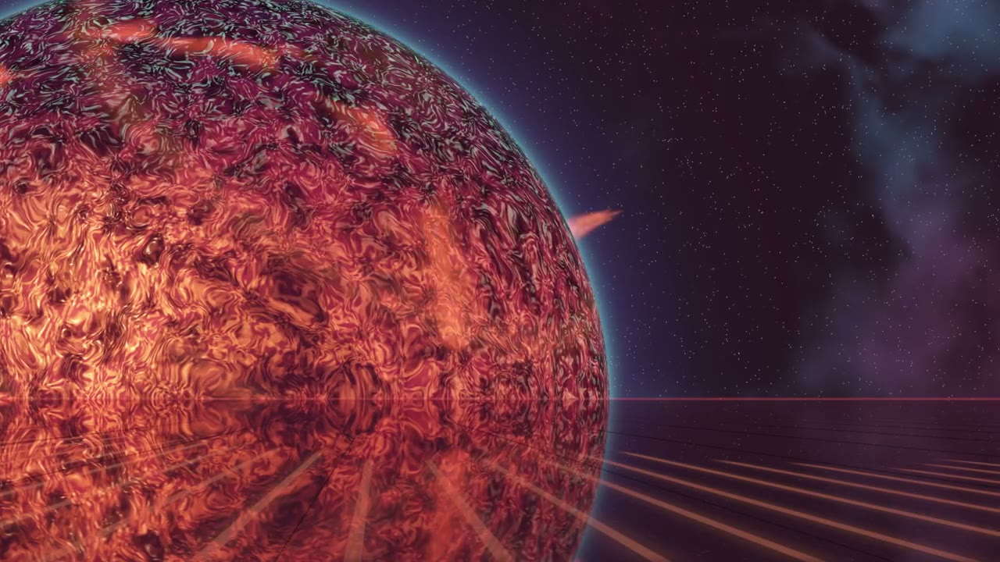
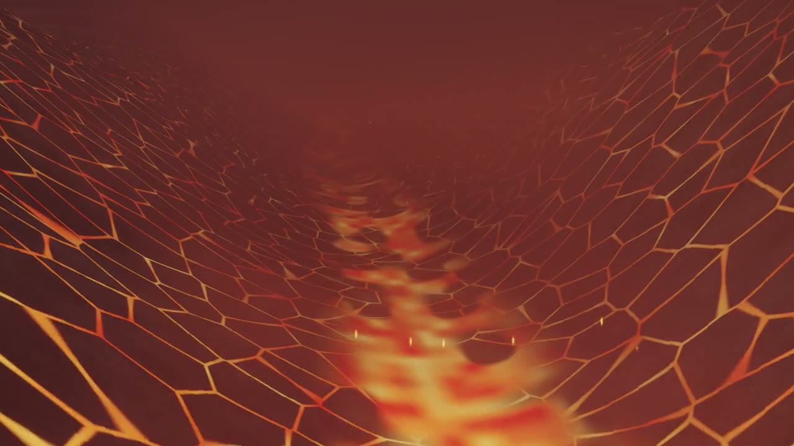
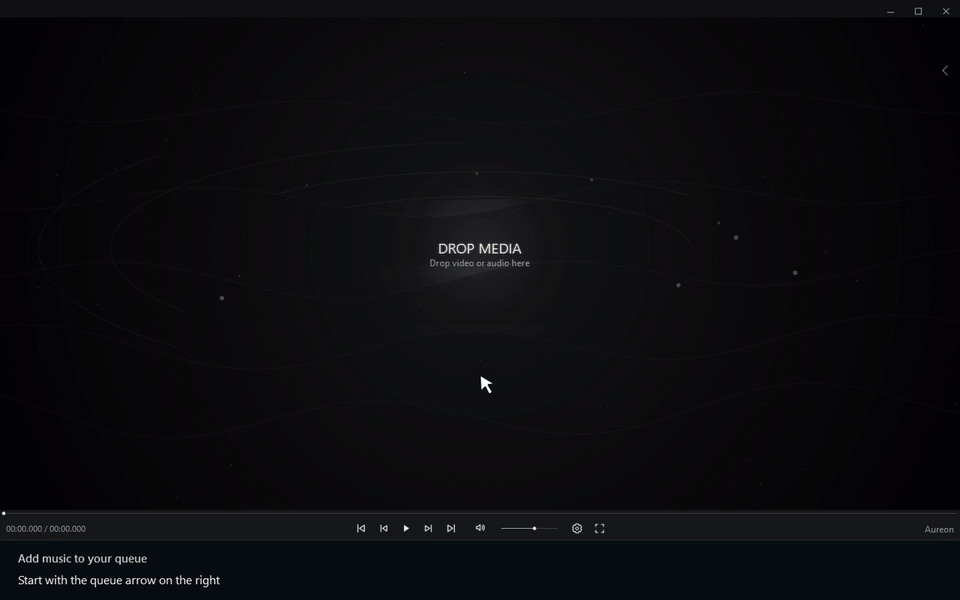

  

<h1 align="center">Aureon</h1>

<h3 align="center">Your personal music satellite.</h3>

  
  

  
  
  

<a href="README.md">English</a> · <a href="README.ru.md">Русский</a>

**Aureon is a free Windows media player with music-reactive visual scenes, custom projections, and a minimal interface.** Play your local music and video, choose a scene, and make the player part of your listening space.

## About

Aureon combines everyday playback with cinematic visuals. Use the queue to organize your tracks, adjust the interface and visual settings, switch to fullscreen, or control playback from the tray mini-player.

The application is free to use. Supporting its creator is optional.

## Download

**Aureon 0.22.3 · v367 · Windows x64**

**[Download the installer — 177.3 MiB](https://github.com/operfivenine/aureonsatellite/releases/download/v0.22.3-v367/Aureon-0.22.3-v367-Setup-x64.exe)** · [Release notes](https://github.com/operfivenine/aureonsatellite/releases/tag/v0.22.3-v367)

Already have Aureon installed? Start with the [user guide](docs/user-guide.md).

## Features

| Playback | Visuals | Personalization |
| --- | --- | --- |
| Local music and video | 7 built-in visual scenes | Interface colors |
| Queue and search | Music-reactive animation | Classic / Transparent Glass |
| Shuffle and Repeat | Fullscreen | Visual quality and reactive gain |
| Save and import playlists | Separate projections | Custom AURS scenes and AURP projections |
| Playback-session restoration | Spectrum visualizers | Tray mini-player and hotkeys |

## Visual scenes

<table>
<tr>
<td align="center" width="33%"> <strong>Aureon Satellite</strong></td>
<td align="center" width="33%"> <strong>Orbital Sun</strong></td>
<td align="center" width="33%"> <strong>Storm Tornado</strong></td>
</tr>
<tr>
<td align="center"> <strong>Orbital Dawn</strong></td>
<td align="center"> <strong>Stellar Horizon</strong></td>
<td align="center"> <strong>Volcanic Valley</strong></td>
</tr>
</table>

**Warp** is also included. Switch scenes by clicking the scene name inside the player. [Watch the tutorial →](docs/tutorials/03_Choose_Scene.md)

## AURS / AURP library

Expand Aureon with custom visual scenes and floating projections.

| Package | Adds to Aureon | Import from |
| --- | --- | --- |
| **AURS** | A custom visual scene | [Settings → Visuals → Import scene](docs/tutorials/19_Import_AURS_Scene.md) |
| **AURP** | A custom projection | [Settings → Tray](docs/tutorials/20_Tray_Mini_Player.md) |

**[Open the AURS / AURP library →](library/README.md)**

### Create your own scene or projection

The **[Authoring API reference (EN)](library/api/README.md)** covers AURS standard library API **1.1**, five editable technical starters, and packaging / validation tools.

[Getting started](library/api/GETTING_STARTED.md) · [API reference](library/api/API_REFERENCE.md) · [Download the authoring kit](library/aureon-authoring-api-en.zip)

## System requirements

**Windows x64 · OpenGL 3.3 Core for GL scenes · Python and Qt included in the Windows package.**

| Component | Current baseline |
| --- | --- |
| Windows | Windows 11 24H2 / 25H2 tested, including IoT Enterprise LTSC 24H2. The installer accepts Windows 10 build 19045+; Windows 10 runtime has not been tested here. |
| Graphics | OpenGL 3.3 Core driver for the five GL scenes. Orbital Dawn and Warp use QPainter. Iris Xe, GTX 1050 and RTX 3070 tested. |
| CPU / RAM | Minimum not measured. **Core i5-7300HQ / 12 GB** is the lowest tested configuration; it does not establish a 12 GB RAM requirement. |

### Tested on three Windows systems

| System | CPU / RAM | GPU | Windows | FPS guideline |
| --- | --- | --- | --- | --- |
| HP OMEN | i5-7300HQ / 12 GB | GTX 1050 · 2 GB | IoT Enterprise LTSC 24H2 · 26100.9550 | **Up to 60 FPS** |
| MSI Evo E13 Flip | i7-1185G7 / 16 GB | Iris Xe · shared memory | 25H2 · 26200.9457 | **Up to 60 FPS** |
| Desktop | i5-13600KF / 32 GB | RTX 3070 · 8 GB | Pro 25H2 · current build 26200.9457 | **60+ FPS** |

Approximate guidelines when choosing quality for each device, rather than averages across all scenes. Frame rate depends on the scene, settings and window size; demanding scenes may run substantially slower. Comparable RTX 3070 measurements show approximately **61–63 drawn frames/s**.

Start with **Auto** and per-scene calibration; use **Lowest** to reduce visual workload on slower machines.

**[Full requirements and scene-by-scene measurements →](SYSTEM_REQUIREMENTS.md)**

## Tested media formats

**79 samples tested: 55 video and 24 audio.**

| Video container | Tested video codecs |
| --- | --- |
| **MP4 / M4V** | H.264, HEVC, AV1, MPEG-4 Part 2, VP9; M4V tested with H.264 |
| **MKV** | H.264, HEVC, AV1, VP9, FFV1 |
| **WebM** | VP8, VP9, AV1 |
| **MOV** | H.264, ProRes, DNxHR, QuickTime Animation |
| **AVI** | MPEG-4 / Xvid, MSMPEG4v3, MJPEG, HuffYUV |
| **WMV / ASF** | WMV1, WMV2 |
| **MPEG / MPG** | MPEG-1, MPEG-2 |
| **TS / M2TS** | TS: H.264, HEVC, MPEG-2; M2TS: H.264 |

| Audio file | Tested audio codecs |
| --- | --- |
| **MP3** | MP3 CBR / VBR |
| **FLAC** | FLAC 16 / 24-bit, up to 192 kHz in tested samples |
| **WAV** | PCM 16 / 24-bit, float32, PCM 5.1, MP3, IMA ADPCM |
| **M4A / AAC** | M4A: AAC-LC, ALAC, Opus; AAC: AAC-LC in ADTS |
| **OGG / OPUS** | OGG: Vorbis, FLAC; OPUS: Opus |

Embedded audio also tested: **AC3 / EAC3, DTS core, TrueHD, WMA2 and MP2** in the corresponding video containers.

Tested 10-bit variants include H.264 High 10, HEVC Main 10, AV1 and VP9. These results describe the tested codec/container combinations.

**[Codec details and audit results →](docs/media-formats.md)**

## Quick start

1. Open the queue with the arrow on the right, click **+ FILES**, and select your media.
2. Click a track in the queue to start playback.
3. Click the scene name to choose a visual background.
4. Press **F11** to enter fullscreen; press it again to return.

<strong>Show how to add music</strong>

[Step-by-step instructions](docs/tutorials/01_Add_Music.md)

<strong>Show how to choose a scene</strong>

[Step-by-step instructions](docs/tutorials/03_Choose_Scene.md)

## User guide

The guide covers **14 topics**, with short UI recordings.

**Drag and drop:** add music from File Explorer; drop video files **directly into the queue**. In a mixed queue, **Show videos first** brings videos to the top without changing playback order.

| I want to… | Open the guide |
| --- | --- |
| Add music or video | [Add music](docs/tutorials/01_Add_Music.md) · [Play video](docs/tutorials/15_Play_Video.md) |
| Organize my music | [Queue and search](docs/tutorials/08_Queue_And_Search.md) · [Playlists](docs/tutorials/22_Save_And_Import_Playlists.md) |
| Choose a visual scene | [Scene Picker](docs/tutorials/03_Choose_Scene.md) · [Scene before playback](docs/tutorials/12_Idle_Scenes.md) |
| Adjust graphics quality | [Visual quality, Advanced and Calibrate Auto](docs/tutorials/26_Visual_Quality.md) |
| Customize the interface | [Colors](docs/tutorials/02_Interface_Themes.md) · [Interface style](docs/tutorials/13_Interface_Style.md) |
| Use tray mode and projections | [Use Tray mode](docs/tutorials/20_Tray_Mini_Player.md) |
| Add my own scene | [Import AURS](docs/tutorials/19_Import_AURS_Scene.md) |

**[Open the user guide →](docs/user-guide.md)**

## Frequently asked questions

<strong>Is Aureon free?</strong>

Yes. Aureon is free to use. Donations are voluntary.

<strong>Does Aureon include a music-streaming catalog?</strong>

No. Aureon plays your local media files. Add music or video from your computer to the queue.

<strong>Can I install custom visuals?</strong>

Yes. Import **.aurs** scenes from Visuals settings and **.aurp** projections from Tray settings.

<strong>Does closing Aureon remember my playback?</strong>

The playback session can restore the current track, queue, and position. Control position restoration through **Settings → Playback → Resume Playback**.

## Powered by FFmpeg / ffprobe

Aureon uses **[FFmpeg](https://ffmpeg.org/)** for media processing and audio analysis, and **[ffprobe](https://ffmpeg.org/ffprobe.html)** for stream information. Thank you to the FFmpeg contributors.

## Feedback and support

- [News on Twitter / X — @aureonsatellite](https://x.com/aureonsatellite).
- [Report an issue](https://github.com/operfivenine/aureonsatellite/issues): include your Aureon version, Windows version, reproduction steps, and relevant screenshots or logs.
- [Support the project on Boosty](https://boosty.to/oper59).
- [Contact the author](mailto:aureonsatellite@gmail.com).

---

<strong>Your music. Your orbit.</strong> Aureon — Your personal music satellite.

