

  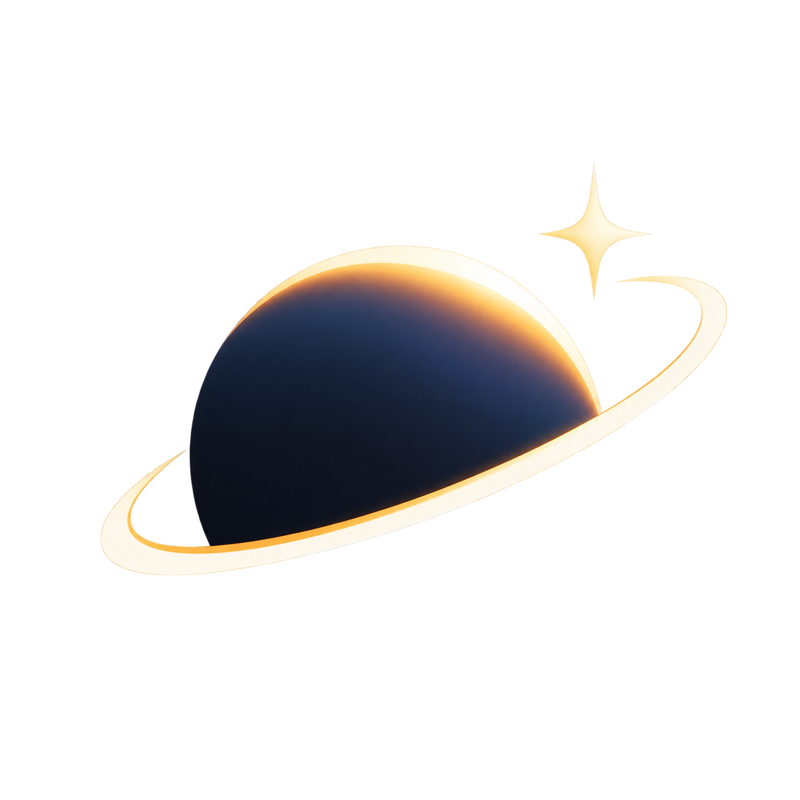

<h1 align="center">Aureon</h1>

<h3 align="center">Your personal music satellite.</h3>

  
  
  
  

  
  
  

<a href="README.md">English</a> · <a href="README.ru.md">Русский</a>

**Aureon is a free media player for Windows, Linux and macOS with music-reactive visual scenes, custom projections, and a minimal interface.** Play your local music and video, choose a scene, and make the player part of your listening space.

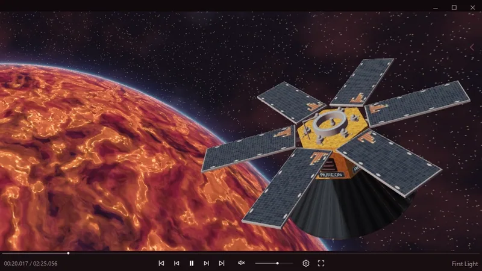

## About

Aureon combines everyday playback with cinematic visuals. Use the queue to organize your tracks, adjust the interface and visual settings, switch to fullscreen, or control playback from the tray mini-player.

The application is free to use. Supporting its creator is optional.

## Download

**Aureon 0.23.0 · v385 — Windows / Linux Beta / macOS Beta**

8 built-in scenes · 4 projections · AURS API 1.1. **Reactive v2** is the default for new profiles; existing profiles keep their saved engine choice.

| Build | System | Packages |
| --- | --- | --- |
| **Windows** | x64 · Windows 10 22H2 / 11 | [EXE installer](https://github.com/operfivenine/aureonsatellite/releases/download/v0.23.0-v385/Aureon-0.23.0-v385-Setup-x64.exe) |
| **Linux · Beta** | x86_64 · tested on Mint 22.3 Cinnamon / X11 | [Run installer](https://github.com/operfivenine/aureonsatellite/releases/download/v0.23.0-v385/Aureon-0.23.0-v385-Linux-Setup-x86_64.run) · [DEB](https://github.com/operfivenine/aureonsatellite/releases/download/v0.23.0-v385/Aureon-0.23.0-v385-Linux-x86_64.deb) |
| **macOS · Beta** | Intel x86_64 · macOS 14+ | [DMG](https://github.com/operfivenine/aureonsatellite/releases/download/v0.23.0-v385/Aureon-0.23.0-v385-macOS-Beta-x86_64.dmg) |

[Package details →](docs/downloads.md) · [Windows changelog →](docs/changelog-windows.md)

Already installed? Start with the [user guide](docs/user-guide.md). Current guide recordings were captured on Windows.

## Features

| Playback | Visuals | Personalization |
| --- | --- | --- |
| Local music and video | 8 built-in visual scenes | Interface colors |
| Queue and search | Music-reactive animation | Classic / Transparent Glass |
| Shuffle and Repeat | Fullscreen | Visual quality and reactive gain |
| Save and import playlists | Separate projections | Custom AURS scenes and AURP projections |
| Playback-session restoration | Spectrum visualizers | Tray mini-player and hotkeys |

## Visual scenes

<table>
<tr>
<td align="center" width="33%">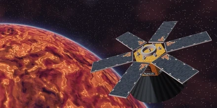 <strong>Aureon Satellite</strong></td>
<td align="center" width="33%">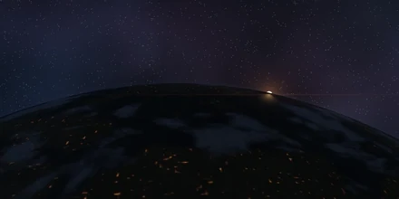 <strong>Orbital Sun</strong></td>
<td align="center" width="33%">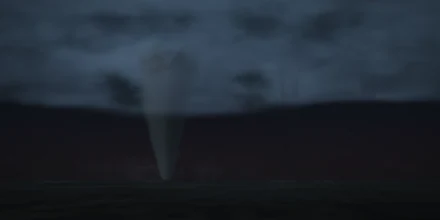 <strong>Storm Tornado</strong></td>
</tr>
<tr>
<td align="center" width="33%">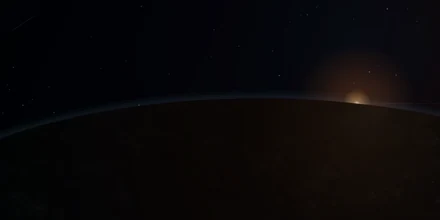 <strong>Orbital Dawn</strong></td>
<td align="center" width="33%">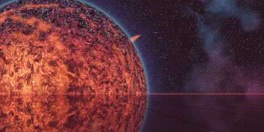 <strong>Stellar Horizon</strong></td>
<td align="center" width="33%">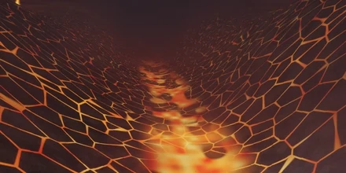 <strong>Volcanic Valley</strong></td>
</tr>
<tr>
<td align="center" colspan="3">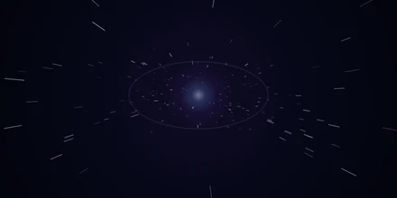 <strong>Warp</strong></td>
</tr>
</table>

The built-in catalog contains **8 scenes and 4 projections**; **Warp** is also included. Switch scenes by clicking the scene name inside the player. [Watch the tutorial →](docs/tutorials/03_Choose_Scene.md)

## AURS catalog

Scroll horizontally and choose a scene.

<table>
<tr>
<td align="center" valign="top" width="260"><a href="library/scenes/nacre-helix/README.md">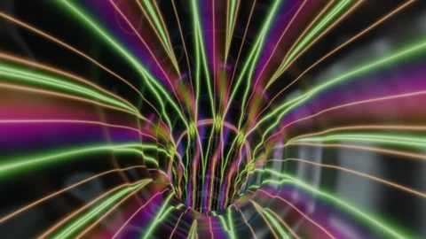 <strong>Nacre Helix</strong></a> &nbsp;&nbsp;&nbsp;&nbsp;&nbsp;&nbsp;&nbsp;&nbsp;&nbsp;&nbsp;&nbsp;&nbsp;&nbsp;&nbsp;&nbsp;&nbsp;&nbsp;&nbsp;&nbsp;&nbsp;&nbsp;&nbsp;&nbsp;&nbsp;&nbsp;&nbsp;&nbsp;&nbsp;&nbsp;&nbsp;&nbsp;&nbsp;&nbsp;&nbsp;&nbsp;&nbsp;&nbsp;&nbsp;&nbsp;&nbsp;&nbsp;&nbsp;&nbsp;&nbsp;&nbsp;&nbsp;&nbsp;&nbsp;&nbsp;&nbsp;&nbsp;&nbsp;&nbsp;&nbsp;&nbsp;&nbsp;&nbsp;&nbsp;&nbsp;&nbsp;&nbsp;&nbsp;&nbsp;&nbsp;&nbsp;&nbsp;&nbsp;&nbsp;&nbsp;&nbsp;&nbsp;&nbsp;&nbsp;&nbsp;&nbsp;&nbsp;&nbsp;&nbsp;&nbsp;&nbsp;</td>
<td align="center" valign="top" width="260"><a href="library/scenes/amber-horizon/README.md">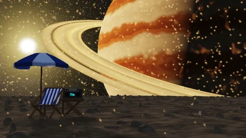 <strong>Amber Horizon</strong></a> &nbsp;&nbsp;&nbsp;&nbsp;&nbsp;&nbsp;&nbsp;&nbsp;&nbsp;&nbsp;&nbsp;&nbsp;&nbsp;&nbsp;&nbsp;&nbsp;&nbsp;&nbsp;&nbsp;&nbsp;&nbsp;&nbsp;&nbsp;&nbsp;&nbsp;&nbsp;&nbsp;&nbsp;&nbsp;&nbsp;&nbsp;&nbsp;&nbsp;&nbsp;&nbsp;&nbsp;&nbsp;&nbsp;&nbsp;&nbsp;&nbsp;&nbsp;&nbsp;&nbsp;&nbsp;&nbsp;&nbsp;&nbsp;&nbsp;&nbsp;&nbsp;&nbsp;&nbsp;&nbsp;&nbsp;&nbsp;&nbsp;&nbsp;&nbsp;&nbsp;&nbsp;&nbsp;&nbsp;&nbsp;&nbsp;&nbsp;&nbsp;&nbsp;&nbsp;&nbsp;&nbsp;&nbsp;&nbsp;&nbsp;&nbsp;&nbsp;&nbsp;&nbsp;&nbsp;&nbsp;</td>
<td align="center" valign="top" width="260"><a href="library/scenes/aureon-voyager/README.md">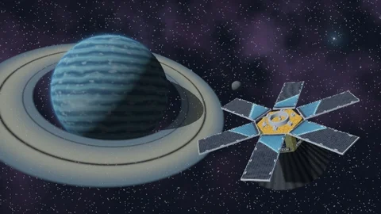 <strong>Aureon Voyager</strong></a> &nbsp;&nbsp;&nbsp;&nbsp;&nbsp;&nbsp;&nbsp;&nbsp;&nbsp;&nbsp;&nbsp;&nbsp;&nbsp;&nbsp;&nbsp;&nbsp;&nbsp;&nbsp;&nbsp;&nbsp;&nbsp;&nbsp;&nbsp;&nbsp;&nbsp;&nbsp;&nbsp;&nbsp;&nbsp;&nbsp;&nbsp;&nbsp;&nbsp;&nbsp;&nbsp;&nbsp;&nbsp;&nbsp;&nbsp;&nbsp;&nbsp;&nbsp;&nbsp;&nbsp;&nbsp;&nbsp;&nbsp;&nbsp;&nbsp;&nbsp;&nbsp;&nbsp;&nbsp;&nbsp;&nbsp;&nbsp;&nbsp;&nbsp;&nbsp;&nbsp;&nbsp;&nbsp;&nbsp;&nbsp;&nbsp;&nbsp;&nbsp;&nbsp;&nbsp;&nbsp;&nbsp;&nbsp;&nbsp;&nbsp;&nbsp;&nbsp;&nbsp;&nbsp;&nbsp;&nbsp;</td>
<td align="center" valign="top" width="260"><a href="library/scenes/acheron-drift/README.md">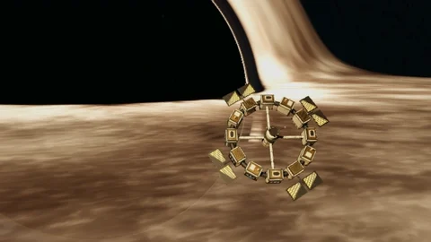 <strong>Acheron Drift</strong></a> &nbsp;&nbsp;&nbsp;&nbsp;&nbsp;&nbsp;&nbsp;&nbsp;&nbsp;&nbsp;&nbsp;&nbsp;&nbsp;&nbsp;&nbsp;&nbsp;&nbsp;&nbsp;&nbsp;&nbsp;&nbsp;&nbsp;&nbsp;&nbsp;&nbsp;&nbsp;&nbsp;&nbsp;&nbsp;&nbsp;&nbsp;&nbsp;&nbsp;&nbsp;&nbsp;&nbsp;&nbsp;&nbsp;&nbsp;&nbsp;&nbsp;&nbsp;&nbsp;&nbsp;&nbsp;&nbsp;&nbsp;&nbsp;&nbsp;&nbsp;&nbsp;&nbsp;&nbsp;&nbsp;&nbsp;&nbsp;&nbsp;&nbsp;&nbsp;&nbsp;&nbsp;&nbsp;&nbsp;&nbsp;&nbsp;&nbsp;&nbsp;&nbsp;&nbsp;&nbsp;&nbsp;&nbsp;&nbsp;&nbsp;&nbsp;&nbsp;&nbsp;&nbsp;&nbsp;&nbsp;</td>
<td align="center" valign="top" width="260"><a href="library/scenes/asteroid-belt/README.md">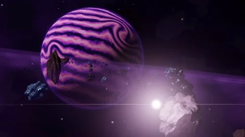 <strong>Asteroid Belt</strong></a> &nbsp;&nbsp;&nbsp;&nbsp;&nbsp;&nbsp;&nbsp;&nbsp;&nbsp;&nbsp;&nbsp;&nbsp;&nbsp;&nbsp;&nbsp;&nbsp;&nbsp;&nbsp;&nbsp;&nbsp;&nbsp;&nbsp;&nbsp;&nbsp;&nbsp;&nbsp;&nbsp;&nbsp;&nbsp;&nbsp;&nbsp;&nbsp;&nbsp;&nbsp;&nbsp;&nbsp;&nbsp;&nbsp;&nbsp;&nbsp;&nbsp;&nbsp;&nbsp;&nbsp;&nbsp;&nbsp;&nbsp;&nbsp;&nbsp;&nbsp;&nbsp;&nbsp;&nbsp;&nbsp;&nbsp;&nbsp;&nbsp;&nbsp;&nbsp;&nbsp;&nbsp;&nbsp;&nbsp;&nbsp;&nbsp;&nbsp;&nbsp;&nbsp;&nbsp;&nbsp;&nbsp;&nbsp;&nbsp;&nbsp;&nbsp;&nbsp;&nbsp;&nbsp;&nbsp;&nbsp;</td>
<td align="center" valign="top" width="260"><a href="library/scenes/aurelia-station/README.md">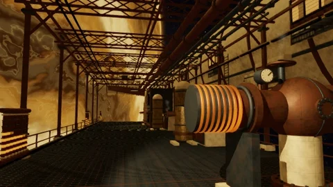 <strong>Aurelia Station</strong></a> &nbsp;&nbsp;&nbsp;&nbsp;&nbsp;&nbsp;&nbsp;&nbsp;&nbsp;&nbsp;&nbsp;&nbsp;&nbsp;&nbsp;&nbsp;&nbsp;&nbsp;&nbsp;&nbsp;&nbsp;&nbsp;&nbsp;&nbsp;&nbsp;&nbsp;&nbsp;&nbsp;&nbsp;&nbsp;&nbsp;&nbsp;&nbsp;&nbsp;&nbsp;&nbsp;&nbsp;&nbsp;&nbsp;&nbsp;&nbsp;&nbsp;&nbsp;&nbsp;&nbsp;&nbsp;&nbsp;&nbsp;&nbsp;&nbsp;&nbsp;&nbsp;&nbsp;&nbsp;&nbsp;&nbsp;&nbsp;&nbsp;&nbsp;&nbsp;&nbsp;&nbsp;&nbsp;&nbsp;&nbsp;&nbsp;&nbsp;&nbsp;&nbsp;&nbsp;&nbsp;&nbsp;&nbsp;&nbsp;&nbsp;&nbsp;&nbsp;&nbsp;&nbsp;&nbsp;&nbsp;</td>
<td align="center" valign="top" width="260"><a href="library/scenes/ember-reach/README.md">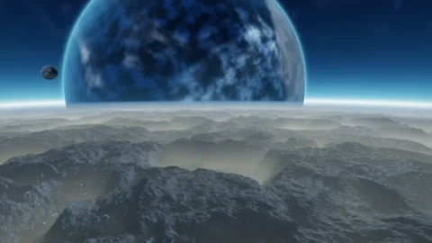 <strong>Ember Reach</strong></a> &nbsp;&nbsp;&nbsp;&nbsp;&nbsp;&nbsp;&nbsp;&nbsp;&nbsp;&nbsp;&nbsp;&nbsp;&nbsp;&nbsp;&nbsp;&nbsp;&nbsp;&nbsp;&nbsp;&nbsp;&nbsp;&nbsp;&nbsp;&nbsp;&nbsp;&nbsp;&nbsp;&nbsp;&nbsp;&nbsp;&nbsp;&nbsp;&nbsp;&nbsp;&nbsp;&nbsp;&nbsp;&nbsp;&nbsp;&nbsp;&nbsp;&nbsp;&nbsp;&nbsp;&nbsp;&nbsp;&nbsp;&nbsp;&nbsp;&nbsp;&nbsp;&nbsp;&nbsp;&nbsp;&nbsp;&nbsp;&nbsp;&nbsp;&nbsp;&nbsp;&nbsp;&nbsp;&nbsp;&nbsp;&nbsp;&nbsp;&nbsp;&nbsp;&nbsp;&nbsp;&nbsp;&nbsp;&nbsp;&nbsp;&nbsp;&nbsp;&nbsp;&nbsp;&nbsp;&nbsp;</td>
<td align="center" valign="top" width="260"><a href="library/scenes/orbital-city/README.md">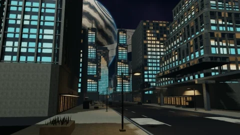 <strong>Orbital City</strong></a> &nbsp;&nbsp;&nbsp;&nbsp;&nbsp;&nbsp;&nbsp;&nbsp;&nbsp;&nbsp;&nbsp;&nbsp;&nbsp;&nbsp;&nbsp;&nbsp;&nbsp;&nbsp;&nbsp;&nbsp;&nbsp;&nbsp;&nbsp;&nbsp;&nbsp;&nbsp;&nbsp;&nbsp;&nbsp;&nbsp;&nbsp;&nbsp;&nbsp;&nbsp;&nbsp;&nbsp;&nbsp;&nbsp;&nbsp;&nbsp;&nbsp;&nbsp;&nbsp;&nbsp;&nbsp;&nbsp;&nbsp;&nbsp;&nbsp;&nbsp;&nbsp;&nbsp;&nbsp;&nbsp;&nbsp;&nbsp;&nbsp;&nbsp;&nbsp;&nbsp;&nbsp;&nbsp;&nbsp;&nbsp;&nbsp;&nbsp;&nbsp;&nbsp;&nbsp;&nbsp;&nbsp;&nbsp;&nbsp;&nbsp;&nbsp;&nbsp;&nbsp;&nbsp;&nbsp;&nbsp;</td>
<td align="center" valign="top" width="260"><a href="library/scenes/thalassa-drift/README.md">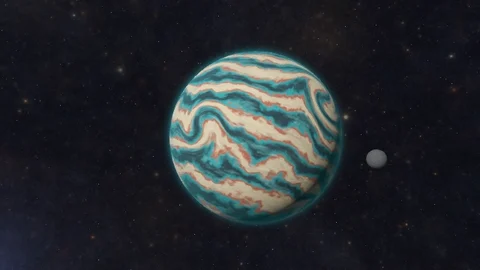 <strong>Thalassa Drift</strong></a> &nbsp;&nbsp;&nbsp;&nbsp;&nbsp;&nbsp;&nbsp;&nbsp;&nbsp;&nbsp;&nbsp;&nbsp;&nbsp;&nbsp;&nbsp;&nbsp;&nbsp;&nbsp;&nbsp;&nbsp;&nbsp;&nbsp;&nbsp;&nbsp;&nbsp;&nbsp;&nbsp;&nbsp;&nbsp;&nbsp;&nbsp;&nbsp;&nbsp;&nbsp;&nbsp;&nbsp;&nbsp;&nbsp;&nbsp;&nbsp;&nbsp;&nbsp;&nbsp;&nbsp;&nbsp;&nbsp;&nbsp;&nbsp;&nbsp;&nbsp;&nbsp;&nbsp;&nbsp;&nbsp;&nbsp;&nbsp;&nbsp;&nbsp;&nbsp;&nbsp;&nbsp;&nbsp;&nbsp;&nbsp;&nbsp;&nbsp;&nbsp;&nbsp;&nbsp;&nbsp;&nbsp;&nbsp;&nbsp;&nbsp;&nbsp;&nbsp;&nbsp;&nbsp;&nbsp;&nbsp;</td>
<td align="center" valign="top" width="260"><a href="library/scenes/afterhours-spire/README.md">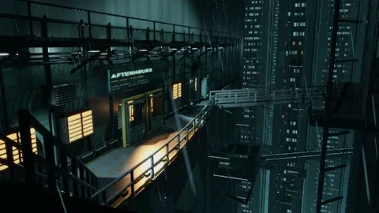 <strong>Afterhours Spire</strong></a> &nbsp;&nbsp;&nbsp;&nbsp;&nbsp;&nbsp;&nbsp;&nbsp;&nbsp;&nbsp;&nbsp;&nbsp;&nbsp;&nbsp;&nbsp;&nbsp;&nbsp;&nbsp;&nbsp;&nbsp;&nbsp;&nbsp;&nbsp;&nbsp;&nbsp;&nbsp;&nbsp;&nbsp;&nbsp;&nbsp;&nbsp;&nbsp;&nbsp;&nbsp;&nbsp;&nbsp;&nbsp;&nbsp;&nbsp;&nbsp;&nbsp;&nbsp;&nbsp;&nbsp;&nbsp;&nbsp;&nbsp;&nbsp;&nbsp;&nbsp;&nbsp;&nbsp;&nbsp;&nbsp;&nbsp;&nbsp;&nbsp;&nbsp;&nbsp;&nbsp;&nbsp;&nbsp;&nbsp;&nbsp;&nbsp;&nbsp;&nbsp;&nbsp;&nbsp;&nbsp;&nbsp;&nbsp;&nbsp;&nbsp;&nbsp;&nbsp;&nbsp;&nbsp;&nbsp;&nbsp;</td>
<td align="center" valign="top" width="260"><a href="library/scenes/sublevel-88/README.md">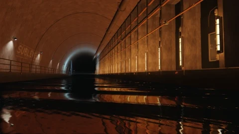 <strong>Sublevel 88</strong></a> &nbsp;&nbsp;&nbsp;&nbsp;&nbsp;&nbsp;&nbsp;&nbsp;&nbsp;&nbsp;&nbsp;&nbsp;&nbsp;&nbsp;&nbsp;&nbsp;&nbsp;&nbsp;&nbsp;&nbsp;&nbsp;&nbsp;&nbsp;&nbsp;&nbsp;&nbsp;&nbsp;&nbsp;&nbsp;&nbsp;&nbsp;&nbsp;&nbsp;&nbsp;&nbsp;&nbsp;&nbsp;&nbsp;&nbsp;&nbsp;&nbsp;&nbsp;&nbsp;&nbsp;&nbsp;&nbsp;&nbsp;&nbsp;&nbsp;&nbsp;&nbsp;&nbsp;&nbsp;&nbsp;&nbsp;&nbsp;&nbsp;&nbsp;&nbsp;&nbsp;&nbsp;&nbsp;&nbsp;&nbsp;&nbsp;&nbsp;&nbsp;&nbsp;&nbsp;&nbsp;&nbsp;&nbsp;&nbsp;&nbsp;&nbsp;&nbsp;&nbsp;&nbsp;&nbsp;&nbsp;</td>
<td align="center" valign="top" width="260"><a href="library/scenes/dead-air/README.md">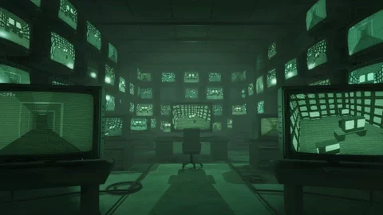 <strong>Dead Air</strong></a> &nbsp;&nbsp;&nbsp;&nbsp;&nbsp;&nbsp;&nbsp;&nbsp;&nbsp;&nbsp;&nbsp;&nbsp;&nbsp;&nbsp;&nbsp;&nbsp;&nbsp;&nbsp;&nbsp;&nbsp;&nbsp;&nbsp;&nbsp;&nbsp;&nbsp;&nbsp;&nbsp;&nbsp;&nbsp;&nbsp;&nbsp;&nbsp;&nbsp;&nbsp;&nbsp;&nbsp;&nbsp;&nbsp;&nbsp;&nbsp;&nbsp;&nbsp;&nbsp;&nbsp;&nbsp;&nbsp;&nbsp;&nbsp;&nbsp;&nbsp;&nbsp;&nbsp;&nbsp;&nbsp;&nbsp;&nbsp;&nbsp;&nbsp;&nbsp;&nbsp;&nbsp;&nbsp;&nbsp;&nbsp;&nbsp;&nbsp;&nbsp;&nbsp;&nbsp;&nbsp;&nbsp;&nbsp;&nbsp;&nbsp;&nbsp;&nbsp;&nbsp;&nbsp;&nbsp;&nbsp;</td>
<td align="center" valign="top" width="260"><a href="library/scenes/drowned-current/README.md">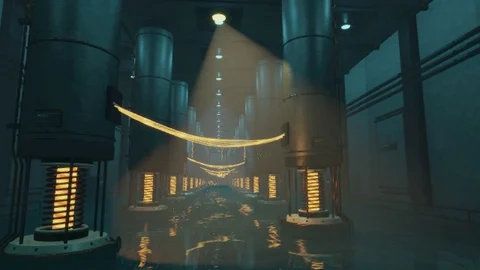 <strong>Drowned Current</strong></a> &nbsp;&nbsp;&nbsp;&nbsp;&nbsp;&nbsp;&nbsp;&nbsp;&nbsp;&nbsp;&nbsp;&nbsp;&nbsp;&nbsp;&nbsp;&nbsp;&nbsp;&nbsp;&nbsp;&nbsp;&nbsp;&nbsp;&nbsp;&nbsp;&nbsp;&nbsp;&nbsp;&nbsp;&nbsp;&nbsp;&nbsp;&nbsp;&nbsp;&nbsp;&nbsp;&nbsp;&nbsp;&nbsp;&nbsp;&nbsp;&nbsp;&nbsp;&nbsp;&nbsp;&nbsp;&nbsp;&nbsp;&nbsp;&nbsp;&nbsp;&nbsp;&nbsp;&nbsp;&nbsp;&nbsp;&nbsp;&nbsp;&nbsp;&nbsp;&nbsp;&nbsp;&nbsp;&nbsp;&nbsp;&nbsp;&nbsp;&nbsp;&nbsp;&nbsp;&nbsp;&nbsp;&nbsp;&nbsp;&nbsp;&nbsp;&nbsp;&nbsp;&nbsp;&nbsp;&nbsp;</td>
<td align="center" valign="top" width="260"><a href="library/scenes/gravity-choir/README.md">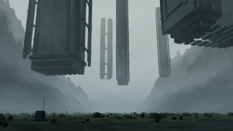 <strong>Gravity Choir</strong></a> &nbsp;&nbsp;&nbsp;&nbsp;&nbsp;&nbsp;&nbsp;&nbsp;&nbsp;&nbsp;&nbsp;&nbsp;&nbsp;&nbsp;&nbsp;&nbsp;&nbsp;&nbsp;&nbsp;&nbsp;&nbsp;&nbsp;&nbsp;&nbsp;&nbsp;&nbsp;&nbsp;&nbsp;&nbsp;&nbsp;&nbsp;&nbsp;&nbsp;&nbsp;&nbsp;&nbsp;&nbsp;&nbsp;&nbsp;&nbsp;&nbsp;&nbsp;&nbsp;&nbsp;&nbsp;&nbsp;&nbsp;&nbsp;&nbsp;&nbsp;&nbsp;&nbsp;&nbsp;&nbsp;&nbsp;&nbsp;&nbsp;&nbsp;&nbsp;&nbsp;&nbsp;&nbsp;&nbsp;&nbsp;&nbsp;&nbsp;&nbsp;&nbsp;&nbsp;&nbsp;&nbsp;&nbsp;&nbsp;&nbsp;&nbsp;&nbsp;&nbsp;&nbsp;&nbsp;&nbsp;</td>
<td align="center" valign="top" width="260"><a href="library/scenes/liminal-relay/README.md">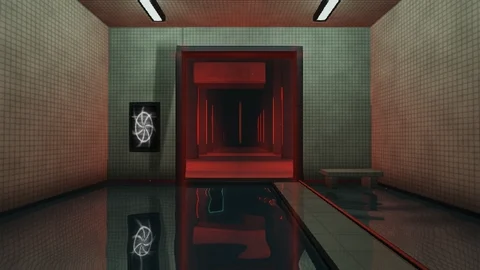 <strong>Liminal Relay</strong></a> &nbsp;&nbsp;&nbsp;&nbsp;&nbsp;&nbsp;&nbsp;&nbsp;&nbsp;&nbsp;&nbsp;&nbsp;&nbsp;&nbsp;&nbsp;&nbsp;&nbsp;&nbsp;&nbsp;&nbsp;&nbsp;&nbsp;&nbsp;&nbsp;&nbsp;&nbsp;&nbsp;&nbsp;&nbsp;&nbsp;&nbsp;&nbsp;&nbsp;&nbsp;&nbsp;&nbsp;&nbsp;&nbsp;&nbsp;&nbsp;&nbsp;&nbsp;&nbsp;&nbsp;&nbsp;&nbsp;&nbsp;&nbsp;&nbsp;&nbsp;&nbsp;&nbsp;&nbsp;&nbsp;&nbsp;&nbsp;&nbsp;&nbsp;&nbsp;&nbsp;&nbsp;&nbsp;&nbsp;&nbsp;&nbsp;&nbsp;&nbsp;&nbsp;&nbsp;&nbsp;&nbsp;&nbsp;&nbsp;&nbsp;&nbsp;&nbsp;&nbsp;&nbsp;&nbsp;&nbsp;</td>
<td align="center" valign="top" width="260"><a href="library/scenes/neon-tenement/README.md">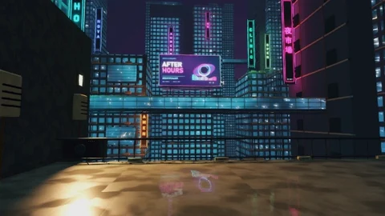 <strong>Neon Tenement</strong></a> &nbsp;&nbsp;&nbsp;&nbsp;&nbsp;&nbsp;&nbsp;&nbsp;&nbsp;&nbsp;&nbsp;&nbsp;&nbsp;&nbsp;&nbsp;&nbsp;&nbsp;&nbsp;&nbsp;&nbsp;&nbsp;&nbsp;&nbsp;&nbsp;&nbsp;&nbsp;&nbsp;&nbsp;&nbsp;&nbsp;&nbsp;&nbsp;&nbsp;&nbsp;&nbsp;&nbsp;&nbsp;&nbsp;&nbsp;&nbsp;&nbsp;&nbsp;&nbsp;&nbsp;&nbsp;&nbsp;&nbsp;&nbsp;&nbsp;&nbsp;&nbsp;&nbsp;&nbsp;&nbsp;&nbsp;&nbsp;&nbsp;&nbsp;&nbsp;&nbsp;&nbsp;&nbsp;&nbsp;&nbsp;&nbsp;&nbsp;&nbsp;&nbsp;&nbsp;&nbsp;&nbsp;&nbsp;&nbsp;&nbsp;&nbsp;&nbsp;&nbsp;&nbsp;&nbsp;&nbsp;</td>
<td align="center" valign="top" width="260"><a href="library/scenes/red-chamber/README.md">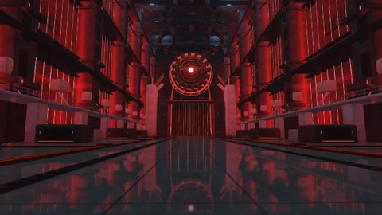 <strong>Red Chamber</strong></a> &nbsp;&nbsp;&nbsp;&nbsp;&nbsp;&nbsp;&nbsp;&nbsp;&nbsp;&nbsp;&nbsp;&nbsp;&nbsp;&nbsp;&nbsp;&nbsp;&nbsp;&nbsp;&nbsp;&nbsp;&nbsp;&nbsp;&nbsp;&nbsp;&nbsp;&nbsp;&nbsp;&nbsp;&nbsp;&nbsp;&nbsp;&nbsp;&nbsp;&nbsp;&nbsp;&nbsp;&nbsp;&nbsp;&nbsp;&nbsp;&nbsp;&nbsp;&nbsp;&nbsp;&nbsp;&nbsp;&nbsp;&nbsp;&nbsp;&nbsp;&nbsp;&nbsp;&nbsp;&nbsp;&nbsp;&nbsp;&nbsp;&nbsp;&nbsp;&nbsp;&nbsp;&nbsp;&nbsp;&nbsp;&nbsp;&nbsp;&nbsp;&nbsp;&nbsp;&nbsp;&nbsp;&nbsp;&nbsp;&nbsp;&nbsp;&nbsp;&nbsp;&nbsp;&nbsp;&nbsp;</td>
<td align="center" valign="top" width="260"><a href="library/scenes/vesper-transit/README.md">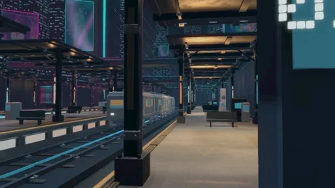 <strong>Vesper Transit</strong></a> &nbsp;&nbsp;&nbsp;&nbsp;&nbsp;&nbsp;&nbsp;&nbsp;&nbsp;&nbsp;&nbsp;&nbsp;&nbsp;&nbsp;&nbsp;&nbsp;&nbsp;&nbsp;&nbsp;&nbsp;&nbsp;&nbsp;&nbsp;&nbsp;&nbsp;&nbsp;&nbsp;&nbsp;&nbsp;&nbsp;&nbsp;&nbsp;&nbsp;&nbsp;&nbsp;&nbsp;&nbsp;&nbsp;&nbsp;&nbsp;&nbsp;&nbsp;&nbsp;&nbsp;&nbsp;&nbsp;&nbsp;&nbsp;&nbsp;&nbsp;&nbsp;&nbsp;&nbsp;&nbsp;&nbsp;&nbsp;&nbsp;&nbsp;&nbsp;&nbsp;&nbsp;&nbsp;&nbsp;&nbsp;&nbsp;&nbsp;&nbsp;&nbsp;&nbsp;&nbsp;&nbsp;&nbsp;&nbsp;&nbsp;&nbsp;&nbsp;&nbsp;&nbsp;&nbsp;&nbsp;</td>
<td align="center" valign="top" width="260"><a href="library/scenes/neon-concourse/README.md">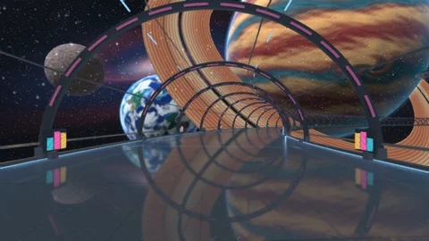 <strong>Neon Concourse</strong></a> &nbsp;&nbsp;&nbsp;&nbsp;&nbsp;&nbsp;&nbsp;&nbsp;&nbsp;&nbsp;&nbsp;&nbsp;&nbsp;&nbsp;&nbsp;&nbsp;&nbsp;&nbsp;&nbsp;&nbsp;&nbsp;&nbsp;&nbsp;&nbsp;&nbsp;&nbsp;&nbsp;&nbsp;&nbsp;&nbsp;&nbsp;&nbsp;&nbsp;&nbsp;&nbsp;&nbsp;&nbsp;&nbsp;&nbsp;&nbsp;&nbsp;&nbsp;&nbsp;&nbsp;&nbsp;&nbsp;&nbsp;&nbsp;&nbsp;&nbsp;&nbsp;&nbsp;&nbsp;&nbsp;&nbsp;&nbsp;&nbsp;&nbsp;&nbsp;&nbsp;&nbsp;&nbsp;&nbsp;&nbsp;&nbsp;&nbsp;&nbsp;&nbsp;&nbsp;&nbsp;&nbsp;&nbsp;&nbsp;&nbsp;&nbsp;&nbsp;&nbsp;&nbsp;&nbsp;&nbsp;</td>
<td align="center" valign="top" width="260"><a href="library/scenes/neon-rain/README.md">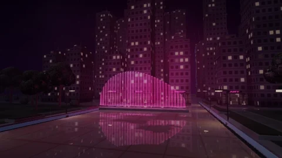 <strong>Neon Rain</strong></a> &nbsp;&nbsp;&nbsp;&nbsp;&nbsp;&nbsp;&nbsp;&nbsp;&nbsp;&nbsp;&nbsp;&nbsp;&nbsp;&nbsp;&nbsp;&nbsp;&nbsp;&nbsp;&nbsp;&nbsp;&nbsp;&nbsp;&nbsp;&nbsp;&nbsp;&nbsp;&nbsp;&nbsp;&nbsp;&nbsp;&nbsp;&nbsp;&nbsp;&nbsp;&nbsp;&nbsp;&nbsp;&nbsp;&nbsp;&nbsp;&nbsp;&nbsp;&nbsp;&nbsp;&nbsp;&nbsp;&nbsp;&nbsp;&nbsp;&nbsp;&nbsp;&nbsp;&nbsp;&nbsp;&nbsp;&nbsp;&nbsp;&nbsp;&nbsp;&nbsp;&nbsp;&nbsp;&nbsp;&nbsp;&nbsp;&nbsp;&nbsp;&nbsp;&nbsp;&nbsp;&nbsp;&nbsp;&nbsp;&nbsp;&nbsp;&nbsp;&nbsp;&nbsp;&nbsp;&nbsp;</td>
<td align="center" valign="top" width="260"><a href="library/scenes/orbital-descent/README.md">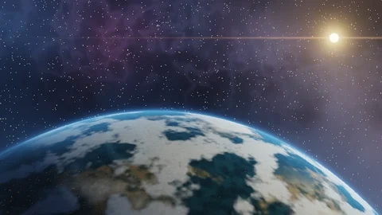 <strong>Orbital Descent</strong></a> &nbsp;&nbsp;&nbsp;&nbsp;&nbsp;&nbsp;&nbsp;&nbsp;&nbsp;&nbsp;&nbsp;&nbsp;&nbsp;&nbsp;&nbsp;&nbsp;&nbsp;&nbsp;&nbsp;&nbsp;&nbsp;&nbsp;&nbsp;&nbsp;&nbsp;&nbsp;&nbsp;&nbsp;&nbsp;&nbsp;&nbsp;&nbsp;&nbsp;&nbsp;&nbsp;&nbsp;&nbsp;&nbsp;&nbsp;&nbsp;&nbsp;&nbsp;&nbsp;&nbsp;&nbsp;&nbsp;&nbsp;&nbsp;&nbsp;&nbsp;&nbsp;&nbsp;&nbsp;&nbsp;&nbsp;&nbsp;&nbsp;&nbsp;&nbsp;&nbsp;&nbsp;&nbsp;&nbsp;&nbsp;&nbsp;&nbsp;&nbsp;&nbsp;&nbsp;&nbsp;&nbsp;&nbsp;&nbsp;&nbsp;&nbsp;&nbsp;&nbsp;&nbsp;&nbsp;&nbsp;</td>
<td align="center" valign="top" width="260"><a href="library/scenes/orbital-habitat/README.md">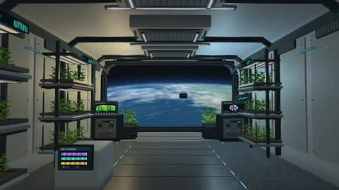 <strong>Orbital Habitat</strong></a> &nbsp;&nbsp;&nbsp;&nbsp;&nbsp;&nbsp;&nbsp;&nbsp;&nbsp;&nbsp;&nbsp;&nbsp;&nbsp;&nbsp;&nbsp;&nbsp;&nbsp;&nbsp;&nbsp;&nbsp;&nbsp;&nbsp;&nbsp;&nbsp;&nbsp;&nbsp;&nbsp;&nbsp;&nbsp;&nbsp;&nbsp;&nbsp;&nbsp;&nbsp;&nbsp;&nbsp;&nbsp;&nbsp;&nbsp;&nbsp;&nbsp;&nbsp;&nbsp;&nbsp;&nbsp;&nbsp;&nbsp;&nbsp;&nbsp;&nbsp;&nbsp;&nbsp;&nbsp;&nbsp;&nbsp;&nbsp;&nbsp;&nbsp;&nbsp;&nbsp;&nbsp;&nbsp;&nbsp;&nbsp;&nbsp;&nbsp;&nbsp;&nbsp;&nbsp;&nbsp;&nbsp;&nbsp;&nbsp;&nbsp;&nbsp;&nbsp;&nbsp;&nbsp;&nbsp;&nbsp;</td>
<td align="center" valign="top" width="260"><a href="library/scenes/wind-atlas/README.md">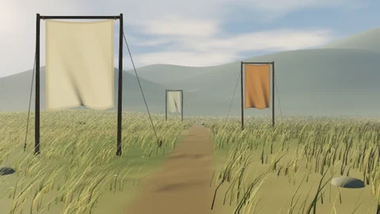 <strong>Wind Atlas</strong></a> &nbsp;&nbsp;&nbsp;&nbsp;&nbsp;&nbsp;&nbsp;&nbsp;&nbsp;&nbsp;&nbsp;&nbsp;&nbsp;&nbsp;&nbsp;&nbsp;&nbsp;&nbsp;&nbsp;&nbsp;&nbsp;&nbsp;&nbsp;&nbsp;&nbsp;&nbsp;&nbsp;&nbsp;&nbsp;&nbsp;&nbsp;&nbsp;&nbsp;&nbsp;&nbsp;&nbsp;&nbsp;&nbsp;&nbsp;&nbsp;&nbsp;&nbsp;&nbsp;&nbsp;&nbsp;&nbsp;&nbsp;&nbsp;&nbsp;&nbsp;&nbsp;&nbsp;&nbsp;&nbsp;&nbsp;&nbsp;&nbsp;&nbsp;&nbsp;&nbsp;&nbsp;&nbsp;&nbsp;&nbsp;&nbsp;&nbsp;&nbsp;&nbsp;&nbsp;&nbsp;&nbsp;&nbsp;&nbsp;&nbsp;&nbsp;&nbsp;&nbsp;&nbsp;&nbsp;&nbsp;</td>
</tr>
</table>

[Full catalog →](library/README.md)

## AURS / AURP library

Expand Aureon with custom visual scenes and floating projections.

[AURS catalog →](library/README.md)

| Package | Adds to Aureon | Import from |
| --- | --- | --- |
| **AURS** | A custom visual scene | [Settings → Visuals → Import scene](docs/tutorials/19_Import_AURS_Scene.md) |
| **AURP** | A custom projection | [Settings → Tray](docs/tutorials/20_Tray_Mini_Player.md) |

**[Open the AURS / AURP library →](library/README.md)**

## Tested systems

| System | CPU / RAM | GPU | OS / environment | Result |
| --- | --- | --- | --- | --- |
| HP OMEN | i5-7300HQ / 12 GB | GTX 1050 · 2 GB | Windows 11 IoT Enterprise LTSC 24H2 · 26100.9550 | Tested; up to 60 FPS¹ |
| MSI Evo E13 Flip | i7-1185G7 / 16 GB | Iris Xe | Windows 11 25H2 · 26200.9457 | Tested; up to 60 FPS¹ |
| Desktop | i5-13600KF / 32 GB | RTX 3070 · 8 GB | **Windows 11 26H2 · 26300.9711** | **Tests passed**; 60+ FPS¹ |
| Linux · VM | — | VMware SVGA3D | Mint 22.3 Cinnamon / X11 · x86_64 | 324 passed, 15 skipped; tray, mini-player, projections and packages |
| macOS · VM | Intel x86_64 | — | macOS · virtual machine | Baseline: 324 passed, 13 skipped²; menus, DPR, launch, signing and DMG |
| iMac · physical device | Intel Core i3 · 4 cores · 3.6 GHz / RAM — | Radeon Pro 555X | macOS · Intel | All tested AURS scenes render correctly |

¹ FPS guidelines are retained from earlier Windows measurements, not new v385 measurements on 26H2. No Linux/macOS FPS values are reported. A dash means details were not provided.

² Later macOS checks covered UI changes and packaging; the complete suite was not rerun.

Start with **Auto** and per-scene calibration. [Full requirements and scene measurements →](SYSTEM_REQUIREMENTS.md)

## Tested media formats

**79 samples previously tested on Windows: 55 video and 24 audio.** An equivalent Linux/macOS matrix is not yet reported.

| Video container | Tested video codecs |
| --- | --- |
| **MP4 / M4V** | H.264, HEVC, AV1, MPEG-4 Part 2, VP9; M4V tested with H.264 |
| **MKV** | H.264, HEVC, AV1, VP9, FFV1 |
| **WebM** | VP8, VP9, AV1 |
| **MOV** | H.264, ProRes, DNxHR, QuickTime Animation |
| **AVI** | MPEG-4 / Xvid, MSMPEG4v3, MJPEG, HuffYUV |
| **WMV / ASF** | WMV1, WMV2 |
| **MPEG / MPG** | MPEG-1, MPEG-2 |
| **TS / M2TS** | TS: H.264, HEVC, MPEG-2; M2TS: H.264 |

| Audio file | Tested audio codecs |
| --- | --- |
| **MP3** | MP3 CBR / VBR |
| **FLAC** | FLAC 16 / 24-bit, up to 192 kHz in tested samples |
| **WAV** | PCM 16 / 24-bit, float32, PCM 5.1, MP3, IMA ADPCM |
| **M4A / AAC** | M4A: AAC-LC, ALAC, Opus; AAC: AAC-LC in ADTS |
| **OGG / OPUS** | OGG: Vorbis, FLAC; OPUS: Opus |

Embedded audio also tested: **AC3 / EAC3, DTS core, TrueHD, WMA2 and MP2** in the corresponding video containers.

Tested 10-bit variants include H.264 High 10, HEVC Main 10, AV1 and VP9. These results describe the tested codec/container combinations.

**[Codec details and audit results →](docs/media-formats.md)**

## Quick start

1. Open the queue with the arrow on the right, click **+ FILES**, and select your media.
2. Click a track in the queue to start playback.
3. Click the scene name to choose a visual background.
4. Press **F11** to enter fullscreen; press it again to return.

<strong>Show how to add music</strong>

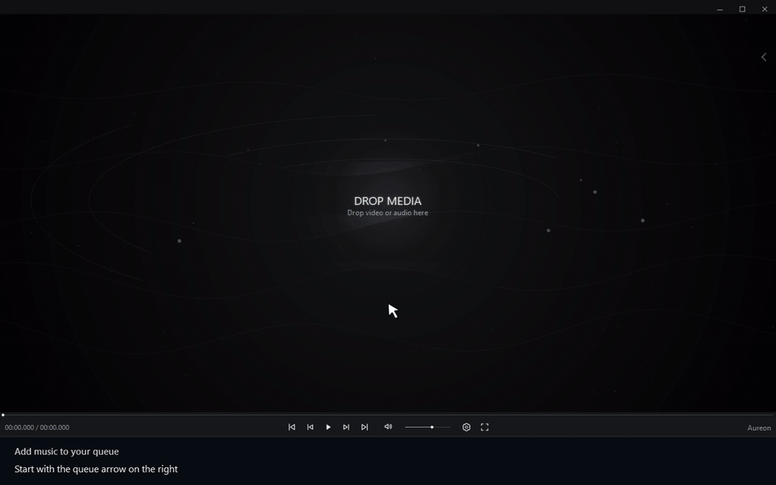

[Step-by-step instructions](docs/tutorials/01_Add_Music.md)

<strong>Show how to choose a scene</strong>

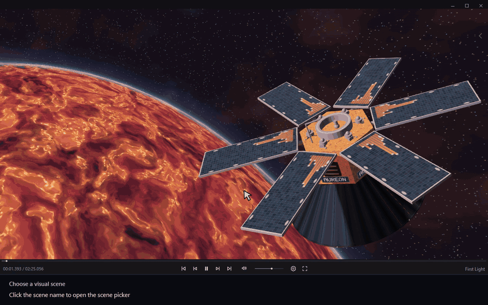

[Step-by-step instructions](docs/tutorials/03_Choose_Scene.md)

## User guide

The guide covers **14 topics**, with short UI recordings.

**Drag and drop:** add music from your file manager; drop video files **directly into the queue**. In a mixed queue, **Show videos first** brings videos to the top without changing playback order.

| I want to… | Open the guide |
| --- | --- |
| Add music or video | [Add music](docs/tutorials/01_Add_Music.md) · [Play video](docs/tutorials/15_Play_Video.md) |
| Organize my music | [Queue and search](docs/tutorials/08_Queue_And_Search.md) · [Playlists](docs/tutorials/22_Save_And_Import_Playlists.md) |
| Choose a visual scene | [Scene Picker](docs/tutorials/03_Choose_Scene.md) · [Scene before playback](docs/tutorials/12_Idle_Scenes.md) |
| Adjust graphics quality | [Visual quality, Advanced and Calibrate Auto](docs/tutorials/26_Visual_Quality.md) |
| Customize the interface | [Colors](docs/tutorials/02_Interface_Themes.md) · [Interface style](docs/tutorials/13_Interface_Style.md) |
| Use tray mode and projections | [Use Tray mode](docs/tutorials/20_Tray_Mini_Player.md) |
| Add my own scene | [Import AURS](docs/tutorials/19_Import_AURS_Scene.md) |

**[Open the user guide →](docs/user-guide.md)**

## Frequently asked questions

<strong>Is Aureon free?</strong>

Yes. Aureon is free to use. Donations are voluntary.

<strong>Does Aureon include a music-streaming catalog?</strong>

No. Aureon plays your local media files. Add music or video from your computer to the queue.

<strong>Can I install custom visuals?</strong>

Yes. Import **.aurs** scenes from Visuals settings and **.aurp** projections from Tray settings.

<strong>Does closing Aureon remember my playback?</strong>

The playback session can restore the current track, queue, and position. Control position restoration through **Settings → Playback → Resume Playback**.

## Powered by FFmpeg / ffprobe

Aureon uses **[FFmpeg](https://ffmpeg.org/)** for media processing and audio analysis, and **[ffprobe](https://ffmpeg.org/ffprobe.html)** for stream information. Thank you to the FFmpeg contributors.

## Feedback and support

- [News on Twitter / X — @aureonsatellite](https://x.com/aureonsatellite).
- [Report an issue](https://github.com/operfivenine/aureonsatellite/issues): include your Aureon version, Windows version, reproduction steps, and relevant screenshots or logs.
- [Support the project on Boosty](https://boosty.to/oper59).
- [Contact the author](mailto:aureonsatellite@gmail.com).

---

<strong>Your music. Your orbit.</strong> Aureon — Your personal music satellite.

