

  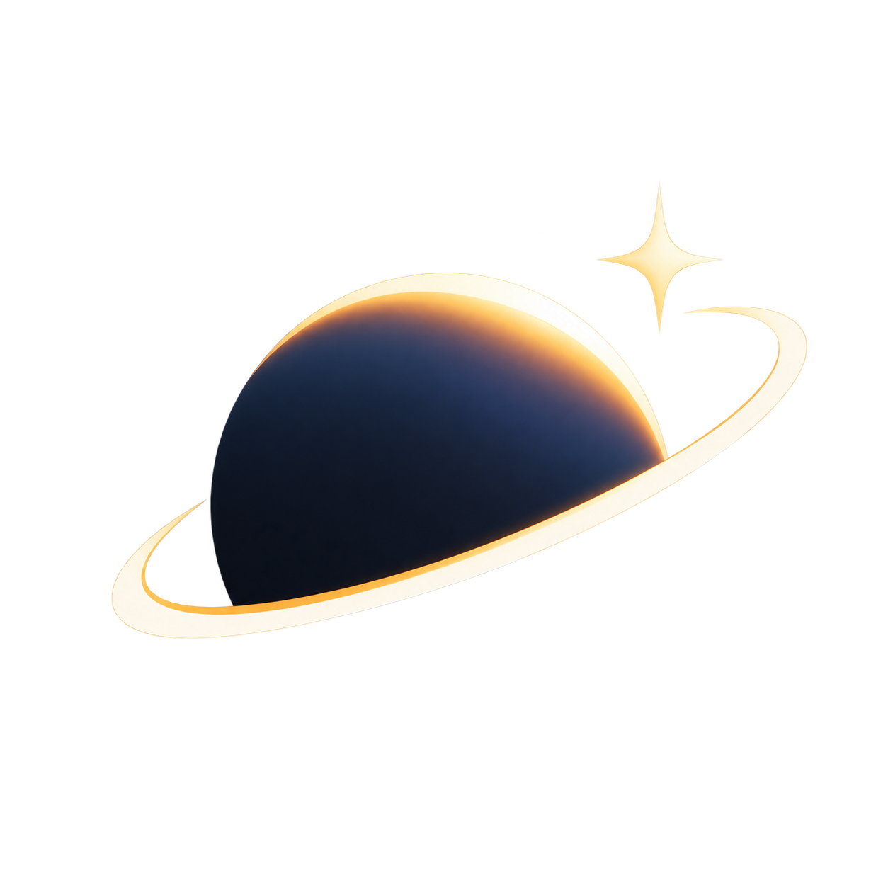

<h1 align="center">Aureon</h1>

<h3 align="center">Your personal music satellite.</h3>

  
  
  
  

  
  
  

<a href="README.md">English</a> · <a href="README.ru.md">Русский</a>

**Aureon — бесплатный медиаплеер для Windows, Linux и macOS с музыкально-реактивными сценами, проекциями и минималистичным интерфейсом.** Слушайте музыку локально, смотрите видео, выбирайте сцену и создавайте своё пространство для прослушивания.

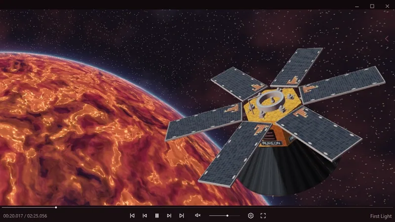

## О приложении

Aureon объединяет воспроизведение и визуальные сцены. Создайте музыкальный плейлист, настройте оформление, включите полноэкранный режим или управляйте музыкой через мини-плеер в трее.

Приложение доступно бесплатно. Поддержка автора — по желанию.

## Скачать

**Aureon 0.23.0 · v385 — Windows / Linux Beta / macOS Beta**

8 встроенных сцен · 4 проекции · AURS API 1.1. **Reactive v2** выбран по умолчанию в новом профиле; сохранённые настройки движка остаются прежними.

| Сборка | Система | Файлы |
| --- | --- | --- |
| **Windows** | x64 · Windows 10 22H2 / 11 | [Установщик EXE](https://github.com/operfivenine/aureonsatellite/releases/download/v0.23.0-v385/Aureon-0.23.0-v385-Setup-x64.exe) |
| **Linux · Beta** | x86_64 · проверено на Mint 22.3 Cinnamon / X11 | [Run-установщик](https://github.com/operfivenine/aureonsatellite/releases/download/v0.23.0-v385/Aureon-0.23.0-v385-Linux-Setup-x86_64.run) · [DEB](https://github.com/operfivenine/aureonsatellite/releases/download/v0.23.0-v385/Aureon-0.23.0-v385-Linux-x86_64.deb) |
| **macOS · Beta** | Intel x86_64 · macOS 14+ | [DMG](https://github.com/operfivenine/aureonsatellite/releases/download/v0.23.0-v385/Aureon-0.23.0-v385-macOS-Beta-x86_64.dmg) |

[Подробнее о файлах →](docs/downloads.ru.md) · [Что нового в Windows →](docs/changelog-windows.ru.md)

Приложение уже установлено? Начните с [руководства пользователя](docs/user-guide.ru.md). Текущие записи руководства сняты на Windows.

## Возможности

| Воспроизведение | Визуализация | Персонализация |
| --- | --- | --- |
| Локальная музыка и видео | 8 встроенных сцен | Цвета интерфейса |
| Очередь и поиск | Реакция на музыку | Classic / Transparent Glass |
| Shuffle и Repeat | Полноэкранный режим | Качество и сила реакции |
| Сохранение и импорт плейлистов | Отдельные проекции | Пользовательские AURS и AURP |
| Восстановление сессии | Спектральные визуализаторы | Трей и горячие клавиши |

## Визуальные сцены

<table>
<tr>
<td align="center" width="33%">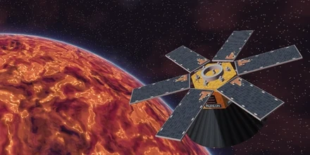 <strong>Aureon Satellite</strong></td>
<td align="center" width="33%">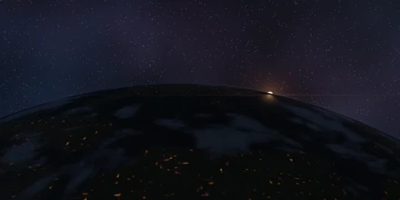 <strong>Orbital Sun</strong></td>
<td align="center" width="33%">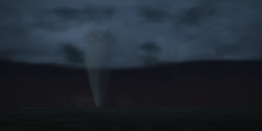 <strong>Storm Tornado</strong></td>
</tr>
<tr>
<td align="center" width="33%">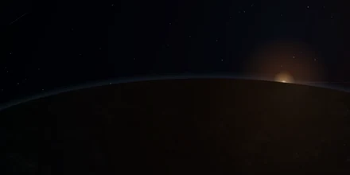 <strong>Orbital Dawn</strong></td>
<td align="center" width="33%">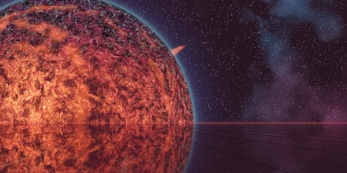 <strong>Stellar Horizon</strong></td>
<td align="center" width="33%">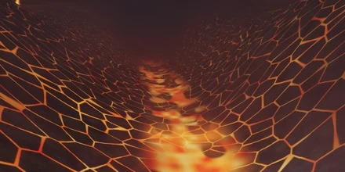 <strong>Volcanic Valley</strong></td>
</tr>
<tr>
<td align="center" colspan="3">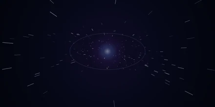 <strong>Warp</strong></td>
</tr>
</table>

Встроенный каталог содержит **8 сцен и 4 проекции**; среди сцен также есть **Warp**. Нажмите название сцены внутри плеера, чтобы выбрать другую. [Посмотреть инструкцию →](docs/tutorials/03_Choose_Scene.ru.md)

## Каталог AURS

Прокрутите ленту и выберите сцену.

<table>
<tr>
<td align="center" valign="top" width="260"><a href="library/scenes/nacre-helix.ru.md">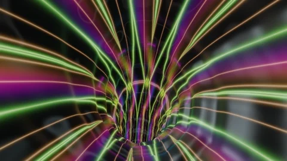 <strong>Nacre Helix</strong></a> &nbsp;&nbsp;&nbsp;&nbsp;&nbsp;&nbsp;&nbsp;&nbsp;&nbsp;&nbsp;&nbsp;&nbsp;&nbsp;&nbsp;&nbsp;&nbsp;&nbsp;&nbsp;&nbsp;&nbsp;&nbsp;&nbsp;&nbsp;&nbsp;&nbsp;&nbsp;&nbsp;&nbsp;&nbsp;&nbsp;&nbsp;&nbsp;&nbsp;&nbsp;&nbsp;&nbsp;&nbsp;&nbsp;&nbsp;&nbsp;&nbsp;&nbsp;&nbsp;&nbsp;&nbsp;&nbsp;&nbsp;&nbsp;&nbsp;&nbsp;&nbsp;&nbsp;&nbsp;&nbsp;&nbsp;&nbsp;&nbsp;&nbsp;&nbsp;&nbsp;&nbsp;&nbsp;&nbsp;&nbsp;&nbsp;&nbsp;&nbsp;&nbsp;&nbsp;&nbsp;&nbsp;&nbsp;&nbsp;&nbsp;&nbsp;&nbsp;&nbsp;&nbsp;&nbsp;&nbsp;</td>
<td align="center" valign="top" width="260"><a href="library/scenes/amber-horizon.ru.md">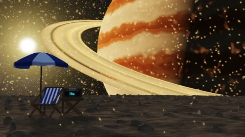 <strong>Amber Horizon</strong></a> &nbsp;&nbsp;&nbsp;&nbsp;&nbsp;&nbsp;&nbsp;&nbsp;&nbsp;&nbsp;&nbsp;&nbsp;&nbsp;&nbsp;&nbsp;&nbsp;&nbsp;&nbsp;&nbsp;&nbsp;&nbsp;&nbsp;&nbsp;&nbsp;&nbsp;&nbsp;&nbsp;&nbsp;&nbsp;&nbsp;&nbsp;&nbsp;&nbsp;&nbsp;&nbsp;&nbsp;&nbsp;&nbsp;&nbsp;&nbsp;&nbsp;&nbsp;&nbsp;&nbsp;&nbsp;&nbsp;&nbsp;&nbsp;&nbsp;&nbsp;&nbsp;&nbsp;&nbsp;&nbsp;&nbsp;&nbsp;&nbsp;&nbsp;&nbsp;&nbsp;&nbsp;&nbsp;&nbsp;&nbsp;&nbsp;&nbsp;&nbsp;&nbsp;&nbsp;&nbsp;&nbsp;&nbsp;&nbsp;&nbsp;&nbsp;&nbsp;&nbsp;&nbsp;&nbsp;&nbsp;</td>
<td align="center" valign="top" width="260"><a href="library/scenes/aureon-voyager.ru.md">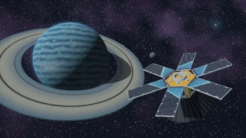 <strong>Aureon Voyager</strong></a> &nbsp;&nbsp;&nbsp;&nbsp;&nbsp;&nbsp;&nbsp;&nbsp;&nbsp;&nbsp;&nbsp;&nbsp;&nbsp;&nbsp;&nbsp;&nbsp;&nbsp;&nbsp;&nbsp;&nbsp;&nbsp;&nbsp;&nbsp;&nbsp;&nbsp;&nbsp;&nbsp;&nbsp;&nbsp;&nbsp;&nbsp;&nbsp;&nbsp;&nbsp;&nbsp;&nbsp;&nbsp;&nbsp;&nbsp;&nbsp;&nbsp;&nbsp;&nbsp;&nbsp;&nbsp;&nbsp;&nbsp;&nbsp;&nbsp;&nbsp;&nbsp;&nbsp;&nbsp;&nbsp;&nbsp;&nbsp;&nbsp;&nbsp;&nbsp;&nbsp;&nbsp;&nbsp;&nbsp;&nbsp;&nbsp;&nbsp;&nbsp;&nbsp;&nbsp;&nbsp;&nbsp;&nbsp;&nbsp;&nbsp;&nbsp;&nbsp;&nbsp;&nbsp;&nbsp;&nbsp;</td>
<td align="center" valign="top" width="260"><a href="library/scenes/acheron-drift.ru.md">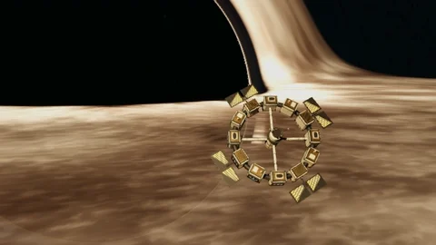 <strong>Acheron Drift</strong></a> &nbsp;&nbsp;&nbsp;&nbsp;&nbsp;&nbsp;&nbsp;&nbsp;&nbsp;&nbsp;&nbsp;&nbsp;&nbsp;&nbsp;&nbsp;&nbsp;&nbsp;&nbsp;&nbsp;&nbsp;&nbsp;&nbsp;&nbsp;&nbsp;&nbsp;&nbsp;&nbsp;&nbsp;&nbsp;&nbsp;&nbsp;&nbsp;&nbsp;&nbsp;&nbsp;&nbsp;&nbsp;&nbsp;&nbsp;&nbsp;&nbsp;&nbsp;&nbsp;&nbsp;&nbsp;&nbsp;&nbsp;&nbsp;&nbsp;&nbsp;&nbsp;&nbsp;&nbsp;&nbsp;&nbsp;&nbsp;&nbsp;&nbsp;&nbsp;&nbsp;&nbsp;&nbsp;&nbsp;&nbsp;&nbsp;&nbsp;&nbsp;&nbsp;&nbsp;&nbsp;&nbsp;&nbsp;&nbsp;&nbsp;&nbsp;&nbsp;&nbsp;&nbsp;&nbsp;&nbsp;</td>
<td align="center" valign="top" width="260"><a href="library/scenes/asteroid-belt.ru.md">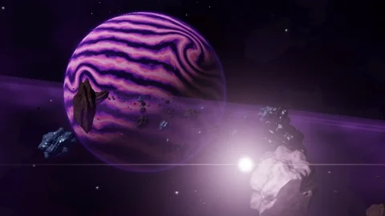 <strong>Asteroid Belt</strong></a> &nbsp;&nbsp;&nbsp;&nbsp;&nbsp;&nbsp;&nbsp;&nbsp;&nbsp;&nbsp;&nbsp;&nbsp;&nbsp;&nbsp;&nbsp;&nbsp;&nbsp;&nbsp;&nbsp;&nbsp;&nbsp;&nbsp;&nbsp;&nbsp;&nbsp;&nbsp;&nbsp;&nbsp;&nbsp;&nbsp;&nbsp;&nbsp;&nbsp;&nbsp;&nbsp;&nbsp;&nbsp;&nbsp;&nbsp;&nbsp;&nbsp;&nbsp;&nbsp;&nbsp;&nbsp;&nbsp;&nbsp;&nbsp;&nbsp;&nbsp;&nbsp;&nbsp;&nbsp;&nbsp;&nbsp;&nbsp;&nbsp;&nbsp;&nbsp;&nbsp;&nbsp;&nbsp;&nbsp;&nbsp;&nbsp;&nbsp;&nbsp;&nbsp;&nbsp;&nbsp;&nbsp;&nbsp;&nbsp;&nbsp;&nbsp;&nbsp;&nbsp;&nbsp;&nbsp;&nbsp;</td>
<td align="center" valign="top" width="260"><a href="library/scenes/aurelia-station.ru.md">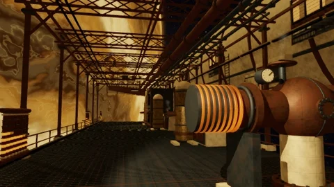 <strong>Aurelia Station</strong></a> &nbsp;&nbsp;&nbsp;&nbsp;&nbsp;&nbsp;&nbsp;&nbsp;&nbsp;&nbsp;&nbsp;&nbsp;&nbsp;&nbsp;&nbsp;&nbsp;&nbsp;&nbsp;&nbsp;&nbsp;&nbsp;&nbsp;&nbsp;&nbsp;&nbsp;&nbsp;&nbsp;&nbsp;&nbsp;&nbsp;&nbsp;&nbsp;&nbsp;&nbsp;&nbsp;&nbsp;&nbsp;&nbsp;&nbsp;&nbsp;&nbsp;&nbsp;&nbsp;&nbsp;&nbsp;&nbsp;&nbsp;&nbsp;&nbsp;&nbsp;&nbsp;&nbsp;&nbsp;&nbsp;&nbsp;&nbsp;&nbsp;&nbsp;&nbsp;&nbsp;&nbsp;&nbsp;&nbsp;&nbsp;&nbsp;&nbsp;&nbsp;&nbsp;&nbsp;&nbsp;&nbsp;&nbsp;&nbsp;&nbsp;&nbsp;&nbsp;&nbsp;&nbsp;&nbsp;&nbsp;</td>
<td align="center" valign="top" width="260"><a href="library/scenes/ember-reach.ru.md">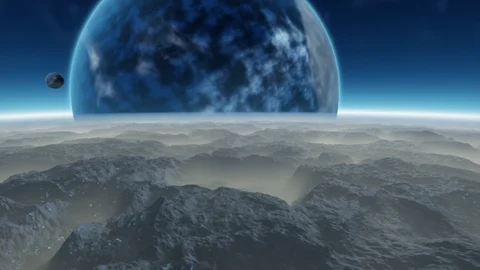 <strong>Ember Reach</strong></a> &nbsp;&nbsp;&nbsp;&nbsp;&nbsp;&nbsp;&nbsp;&nbsp;&nbsp;&nbsp;&nbsp;&nbsp;&nbsp;&nbsp;&nbsp;&nbsp;&nbsp;&nbsp;&nbsp;&nbsp;&nbsp;&nbsp;&nbsp;&nbsp;&nbsp;&nbsp;&nbsp;&nbsp;&nbsp;&nbsp;&nbsp;&nbsp;&nbsp;&nbsp;&nbsp;&nbsp;&nbsp;&nbsp;&nbsp;&nbsp;&nbsp;&nbsp;&nbsp;&nbsp;&nbsp;&nbsp;&nbsp;&nbsp;&nbsp;&nbsp;&nbsp;&nbsp;&nbsp;&nbsp;&nbsp;&nbsp;&nbsp;&nbsp;&nbsp;&nbsp;&nbsp;&nbsp;&nbsp;&nbsp;&nbsp;&nbsp;&nbsp;&nbsp;&nbsp;&nbsp;&nbsp;&nbsp;&nbsp;&nbsp;&nbsp;&nbsp;&nbsp;&nbsp;&nbsp;&nbsp;</td>
<td align="center" valign="top" width="260"><a href="library/scenes/orbital-city.ru.md">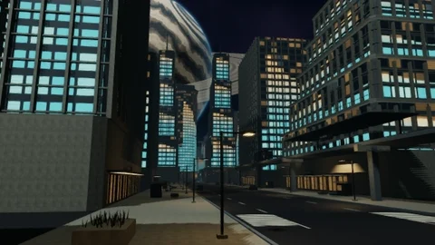 <strong>Orbital City</strong></a> &nbsp;&nbsp;&nbsp;&nbsp;&nbsp;&nbsp;&nbsp;&nbsp;&nbsp;&nbsp;&nbsp;&nbsp;&nbsp;&nbsp;&nbsp;&nbsp;&nbsp;&nbsp;&nbsp;&nbsp;&nbsp;&nbsp;&nbsp;&nbsp;&nbsp;&nbsp;&nbsp;&nbsp;&nbsp;&nbsp;&nbsp;&nbsp;&nbsp;&nbsp;&nbsp;&nbsp;&nbsp;&nbsp;&nbsp;&nbsp;&nbsp;&nbsp;&nbsp;&nbsp;&nbsp;&nbsp;&nbsp;&nbsp;&nbsp;&nbsp;&nbsp;&nbsp;&nbsp;&nbsp;&nbsp;&nbsp;&nbsp;&nbsp;&nbsp;&nbsp;&nbsp;&nbsp;&nbsp;&nbsp;&nbsp;&nbsp;&nbsp;&nbsp;&nbsp;&nbsp;&nbsp;&nbsp;&nbsp;&nbsp;&nbsp;&nbsp;&nbsp;&nbsp;&nbsp;&nbsp;</td>
<td align="center" valign="top" width="260"><a href="library/scenes/thalassa-drift.ru.md">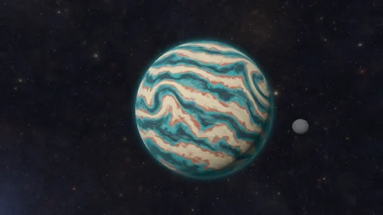 <strong>Thalassa Drift</strong></a> &nbsp;&nbsp;&nbsp;&nbsp;&nbsp;&nbsp;&nbsp;&nbsp;&nbsp;&nbsp;&nbsp;&nbsp;&nbsp;&nbsp;&nbsp;&nbsp;&nbsp;&nbsp;&nbsp;&nbsp;&nbsp;&nbsp;&nbsp;&nbsp;&nbsp;&nbsp;&nbsp;&nbsp;&nbsp;&nbsp;&nbsp;&nbsp;&nbsp;&nbsp;&nbsp;&nbsp;&nbsp;&nbsp;&nbsp;&nbsp;&nbsp;&nbsp;&nbsp;&nbsp;&nbsp;&nbsp;&nbsp;&nbsp;&nbsp;&nbsp;&nbsp;&nbsp;&nbsp;&nbsp;&nbsp;&nbsp;&nbsp;&nbsp;&nbsp;&nbsp;&nbsp;&nbsp;&nbsp;&nbsp;&nbsp;&nbsp;&nbsp;&nbsp;&nbsp;&nbsp;&nbsp;&nbsp;&nbsp;&nbsp;&nbsp;&nbsp;&nbsp;&nbsp;&nbsp;&nbsp;</td>
<td align="center" valign="top" width="260"><a href="library/scenes/afterhours-spire.ru.md">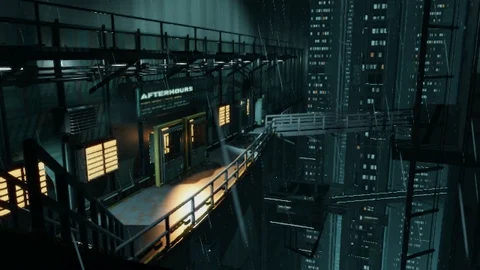 <strong>Afterhours Spire</strong></a> &nbsp;&nbsp;&nbsp;&nbsp;&nbsp;&nbsp;&nbsp;&nbsp;&nbsp;&nbsp;&nbsp;&nbsp;&nbsp;&nbsp;&nbsp;&nbsp;&nbsp;&nbsp;&nbsp;&nbsp;&nbsp;&nbsp;&nbsp;&nbsp;&nbsp;&nbsp;&nbsp;&nbsp;&nbsp;&nbsp;&nbsp;&nbsp;&nbsp;&nbsp;&nbsp;&nbsp;&nbsp;&nbsp;&nbsp;&nbsp;&nbsp;&nbsp;&nbsp;&nbsp;&nbsp;&nbsp;&nbsp;&nbsp;&nbsp;&nbsp;&nbsp;&nbsp;&nbsp;&nbsp;&nbsp;&nbsp;&nbsp;&nbsp;&nbsp;&nbsp;&nbsp;&nbsp;&nbsp;&nbsp;&nbsp;&nbsp;&nbsp;&nbsp;&nbsp;&nbsp;&nbsp;&nbsp;&nbsp;&nbsp;&nbsp;&nbsp;&nbsp;&nbsp;&nbsp;&nbsp;</td>
<td align="center" valign="top" width="260"><a href="library/scenes/sublevel-88.ru.md">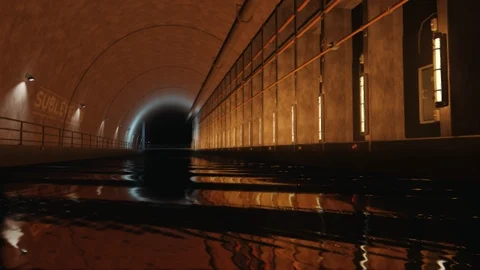 <strong>Sublevel 88</strong></a> &nbsp;&nbsp;&nbsp;&nbsp;&nbsp;&nbsp;&nbsp;&nbsp;&nbsp;&nbsp;&nbsp;&nbsp;&nbsp;&nbsp;&nbsp;&nbsp;&nbsp;&nbsp;&nbsp;&nbsp;&nbsp;&nbsp;&nbsp;&nbsp;&nbsp;&nbsp;&nbsp;&nbsp;&nbsp;&nbsp;&nbsp;&nbsp;&nbsp;&nbsp;&nbsp;&nbsp;&nbsp;&nbsp;&nbsp;&nbsp;&nbsp;&nbsp;&nbsp;&nbsp;&nbsp;&nbsp;&nbsp;&nbsp;&nbsp;&nbsp;&nbsp;&nbsp;&nbsp;&nbsp;&nbsp;&nbsp;&nbsp;&nbsp;&nbsp;&nbsp;&nbsp;&nbsp;&nbsp;&nbsp;&nbsp;&nbsp;&nbsp;&nbsp;&nbsp;&nbsp;&nbsp;&nbsp;&nbsp;&nbsp;&nbsp;&nbsp;&nbsp;&nbsp;&nbsp;&nbsp;</td>
<td align="center" valign="top" width="260"><a href="library/scenes/dead-air.ru.md">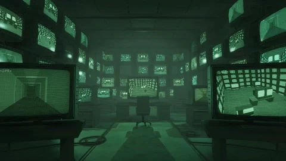 <strong>Dead Air</strong></a> &nbsp;&nbsp;&nbsp;&nbsp;&nbsp;&nbsp;&nbsp;&nbsp;&nbsp;&nbsp;&nbsp;&nbsp;&nbsp;&nbsp;&nbsp;&nbsp;&nbsp;&nbsp;&nbsp;&nbsp;&nbsp;&nbsp;&nbsp;&nbsp;&nbsp;&nbsp;&nbsp;&nbsp;&nbsp;&nbsp;&nbsp;&nbsp;&nbsp;&nbsp;&nbsp;&nbsp;&nbsp;&nbsp;&nbsp;&nbsp;&nbsp;&nbsp;&nbsp;&nbsp;&nbsp;&nbsp;&nbsp;&nbsp;&nbsp;&nbsp;&nbsp;&nbsp;&nbsp;&nbsp;&nbsp;&nbsp;&nbsp;&nbsp;&nbsp;&nbsp;&nbsp;&nbsp;&nbsp;&nbsp;&nbsp;&nbsp;&nbsp;&nbsp;&nbsp;&nbsp;&nbsp;&nbsp;&nbsp;&nbsp;&nbsp;&nbsp;&nbsp;&nbsp;&nbsp;&nbsp;</td>
<td align="center" valign="top" width="260"><a href="library/scenes/drowned-current.ru.md">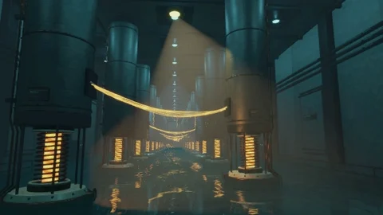 <strong>Drowned Current</strong></a> &nbsp;&nbsp;&nbsp;&nbsp;&nbsp;&nbsp;&nbsp;&nbsp;&nbsp;&nbsp;&nbsp;&nbsp;&nbsp;&nbsp;&nbsp;&nbsp;&nbsp;&nbsp;&nbsp;&nbsp;&nbsp;&nbsp;&nbsp;&nbsp;&nbsp;&nbsp;&nbsp;&nbsp;&nbsp;&nbsp;&nbsp;&nbsp;&nbsp;&nbsp;&nbsp;&nbsp;&nbsp;&nbsp;&nbsp;&nbsp;&nbsp;&nbsp;&nbsp;&nbsp;&nbsp;&nbsp;&nbsp;&nbsp;&nbsp;&nbsp;&nbsp;&nbsp;&nbsp;&nbsp;&nbsp;&nbsp;&nbsp;&nbsp;&nbsp;&nbsp;&nbsp;&nbsp;&nbsp;&nbsp;&nbsp;&nbsp;&nbsp;&nbsp;&nbsp;&nbsp;&nbsp;&nbsp;&nbsp;&nbsp;&nbsp;&nbsp;&nbsp;&nbsp;&nbsp;&nbsp;</td>
<td align="center" valign="top" width="260"><a href="library/scenes/gravity-choir.ru.md">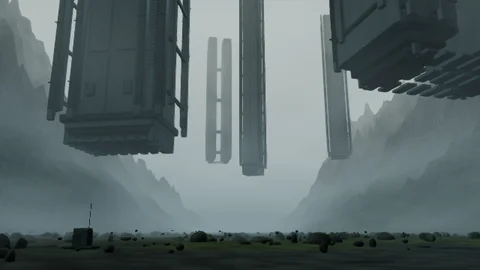 <strong>Gravity Choir</strong></a> &nbsp;&nbsp;&nbsp;&nbsp;&nbsp;&nbsp;&nbsp;&nbsp;&nbsp;&nbsp;&nbsp;&nbsp;&nbsp;&nbsp;&nbsp;&nbsp;&nbsp;&nbsp;&nbsp;&nbsp;&nbsp;&nbsp;&nbsp;&nbsp;&nbsp;&nbsp;&nbsp;&nbsp;&nbsp;&nbsp;&nbsp;&nbsp;&nbsp;&nbsp;&nbsp;&nbsp;&nbsp;&nbsp;&nbsp;&nbsp;&nbsp;&nbsp;&nbsp;&nbsp;&nbsp;&nbsp;&nbsp;&nbsp;&nbsp;&nbsp;&nbsp;&nbsp;&nbsp;&nbsp;&nbsp;&nbsp;&nbsp;&nbsp;&nbsp;&nbsp;&nbsp;&nbsp;&nbsp;&nbsp;&nbsp;&nbsp;&nbsp;&nbsp;&nbsp;&nbsp;&nbsp;&nbsp;&nbsp;&nbsp;&nbsp;&nbsp;&nbsp;&nbsp;&nbsp;&nbsp;</td>
<td align="center" valign="top" width="260"><a href="library/scenes/liminal-relay.ru.md">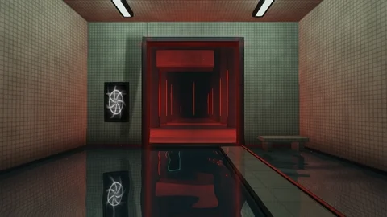 <strong>Liminal Relay</strong></a> &nbsp;&nbsp;&nbsp;&nbsp;&nbsp;&nbsp;&nbsp;&nbsp;&nbsp;&nbsp;&nbsp;&nbsp;&nbsp;&nbsp;&nbsp;&nbsp;&nbsp;&nbsp;&nbsp;&nbsp;&nbsp;&nbsp;&nbsp;&nbsp;&nbsp;&nbsp;&nbsp;&nbsp;&nbsp;&nbsp;&nbsp;&nbsp;&nbsp;&nbsp;&nbsp;&nbsp;&nbsp;&nbsp;&nbsp;&nbsp;&nbsp;&nbsp;&nbsp;&nbsp;&nbsp;&nbsp;&nbsp;&nbsp;&nbsp;&nbsp;&nbsp;&nbsp;&nbsp;&nbsp;&nbsp;&nbsp;&nbsp;&nbsp;&nbsp;&nbsp;&nbsp;&nbsp;&nbsp;&nbsp;&nbsp;&nbsp;&nbsp;&nbsp;&nbsp;&nbsp;&nbsp;&nbsp;&nbsp;&nbsp;&nbsp;&nbsp;&nbsp;&nbsp;&nbsp;&nbsp;</td>
<td align="center" valign="top" width="260"><a href="library/scenes/neon-tenement.ru.md">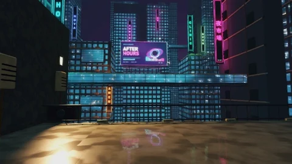 <strong>Neon Tenement</strong></a> &nbsp;&nbsp;&nbsp;&nbsp;&nbsp;&nbsp;&nbsp;&nbsp;&nbsp;&nbsp;&nbsp;&nbsp;&nbsp;&nbsp;&nbsp;&nbsp;&nbsp;&nbsp;&nbsp;&nbsp;&nbsp;&nbsp;&nbsp;&nbsp;&nbsp;&nbsp;&nbsp;&nbsp;&nbsp;&nbsp;&nbsp;&nbsp;&nbsp;&nbsp;&nbsp;&nbsp;&nbsp;&nbsp;&nbsp;&nbsp;&nbsp;&nbsp;&nbsp;&nbsp;&nbsp;&nbsp;&nbsp;&nbsp;&nbsp;&nbsp;&nbsp;&nbsp;&nbsp;&nbsp;&nbsp;&nbsp;&nbsp;&nbsp;&nbsp;&nbsp;&nbsp;&nbsp;&nbsp;&nbsp;&nbsp;&nbsp;&nbsp;&nbsp;&nbsp;&nbsp;&nbsp;&nbsp;&nbsp;&nbsp;&nbsp;&nbsp;&nbsp;&nbsp;&nbsp;&nbsp;</td>
<td align="center" valign="top" width="260"><a href="library/scenes/red-chamber.ru.md">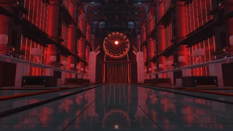 <strong>Red Chamber</strong></a> &nbsp;&nbsp;&nbsp;&nbsp;&nbsp;&nbsp;&nbsp;&nbsp;&nbsp;&nbsp;&nbsp;&nbsp;&nbsp;&nbsp;&nbsp;&nbsp;&nbsp;&nbsp;&nbsp;&nbsp;&nbsp;&nbsp;&nbsp;&nbsp;&nbsp;&nbsp;&nbsp;&nbsp;&nbsp;&nbsp;&nbsp;&nbsp;&nbsp;&nbsp;&nbsp;&nbsp;&nbsp;&nbsp;&nbsp;&nbsp;&nbsp;&nbsp;&nbsp;&nbsp;&nbsp;&nbsp;&nbsp;&nbsp;&nbsp;&nbsp;&nbsp;&nbsp;&nbsp;&nbsp;&nbsp;&nbsp;&nbsp;&nbsp;&nbsp;&nbsp;&nbsp;&nbsp;&nbsp;&nbsp;&nbsp;&nbsp;&nbsp;&nbsp;&nbsp;&nbsp;&nbsp;&nbsp;&nbsp;&nbsp;&nbsp;&nbsp;&nbsp;&nbsp;&nbsp;&nbsp;</td>
<td align="center" valign="top" width="260"><a href="library/scenes/vesper-transit.ru.md">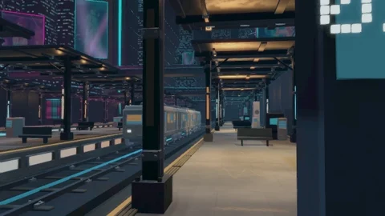 <strong>Vesper Transit</strong></a> &nbsp;&nbsp;&nbsp;&nbsp;&nbsp;&nbsp;&nbsp;&nbsp;&nbsp;&nbsp;&nbsp;&nbsp;&nbsp;&nbsp;&nbsp;&nbsp;&nbsp;&nbsp;&nbsp;&nbsp;&nbsp;&nbsp;&nbsp;&nbsp;&nbsp;&nbsp;&nbsp;&nbsp;&nbsp;&nbsp;&nbsp;&nbsp;&nbsp;&nbsp;&nbsp;&nbsp;&nbsp;&nbsp;&nbsp;&nbsp;&nbsp;&nbsp;&nbsp;&nbsp;&nbsp;&nbsp;&nbsp;&nbsp;&nbsp;&nbsp;&nbsp;&nbsp;&nbsp;&nbsp;&nbsp;&nbsp;&nbsp;&nbsp;&nbsp;&nbsp;&nbsp;&nbsp;&nbsp;&nbsp;&nbsp;&nbsp;&nbsp;&nbsp;&nbsp;&nbsp;&nbsp;&nbsp;&nbsp;&nbsp;&nbsp;&nbsp;&nbsp;&nbsp;&nbsp;&nbsp;</td>
<td align="center" valign="top" width="260"><a href="library/scenes/neon-concourse.ru.md">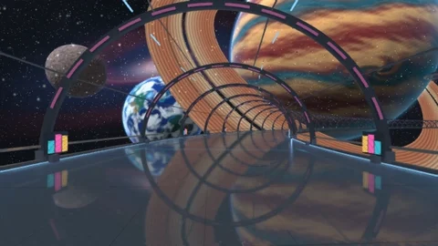 <strong>Neon Concourse</strong></a> &nbsp;&nbsp;&nbsp;&nbsp;&nbsp;&nbsp;&nbsp;&nbsp;&nbsp;&nbsp;&nbsp;&nbsp;&nbsp;&nbsp;&nbsp;&nbsp;&nbsp;&nbsp;&nbsp;&nbsp;&nbsp;&nbsp;&nbsp;&nbsp;&nbsp;&nbsp;&nbsp;&nbsp;&nbsp;&nbsp;&nbsp;&nbsp;&nbsp;&nbsp;&nbsp;&nbsp;&nbsp;&nbsp;&nbsp;&nbsp;&nbsp;&nbsp;&nbsp;&nbsp;&nbsp;&nbsp;&nbsp;&nbsp;&nbsp;&nbsp;&nbsp;&nbsp;&nbsp;&nbsp;&nbsp;&nbsp;&nbsp;&nbsp;&nbsp;&nbsp;&nbsp;&nbsp;&nbsp;&nbsp;&nbsp;&nbsp;&nbsp;&nbsp;&nbsp;&nbsp;&nbsp;&nbsp;&nbsp;&nbsp;&nbsp;&nbsp;&nbsp;&nbsp;&nbsp;&nbsp;</td>
<td align="center" valign="top" width="260"><a href="library/scenes/neon-rain.ru.md">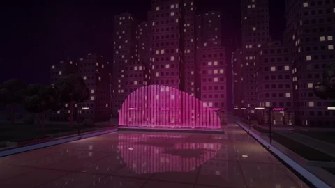 <strong>Neon Rain</strong></a> &nbsp;&nbsp;&nbsp;&nbsp;&nbsp;&nbsp;&nbsp;&nbsp;&nbsp;&nbsp;&nbsp;&nbsp;&nbsp;&nbsp;&nbsp;&nbsp;&nbsp;&nbsp;&nbsp;&nbsp;&nbsp;&nbsp;&nbsp;&nbsp;&nbsp;&nbsp;&nbsp;&nbsp;&nbsp;&nbsp;&nbsp;&nbsp;&nbsp;&nbsp;&nbsp;&nbsp;&nbsp;&nbsp;&nbsp;&nbsp;&nbsp;&nbsp;&nbsp;&nbsp;&nbsp;&nbsp;&nbsp;&nbsp;&nbsp;&nbsp;&nbsp;&nbsp;&nbsp;&nbsp;&nbsp;&nbsp;&nbsp;&nbsp;&nbsp;&nbsp;&nbsp;&nbsp;&nbsp;&nbsp;&nbsp;&nbsp;&nbsp;&nbsp;&nbsp;&nbsp;&nbsp;&nbsp;&nbsp;&nbsp;&nbsp;&nbsp;&nbsp;&nbsp;&nbsp;&nbsp;</td>
<td align="center" valign="top" width="260"><a href="library/scenes/orbital-descent.ru.md">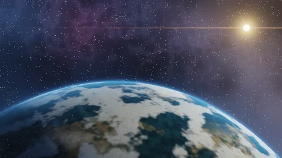 <strong>Orbital Descent</strong></a> &nbsp;&nbsp;&nbsp;&nbsp;&nbsp;&nbsp;&nbsp;&nbsp;&nbsp;&nbsp;&nbsp;&nbsp;&nbsp;&nbsp;&nbsp;&nbsp;&nbsp;&nbsp;&nbsp;&nbsp;&nbsp;&nbsp;&nbsp;&nbsp;&nbsp;&nbsp;&nbsp;&nbsp;&nbsp;&nbsp;&nbsp;&nbsp;&nbsp;&nbsp;&nbsp;&nbsp;&nbsp;&nbsp;&nbsp;&nbsp;&nbsp;&nbsp;&nbsp;&nbsp;&nbsp;&nbsp;&nbsp;&nbsp;&nbsp;&nbsp;&nbsp;&nbsp;&nbsp;&nbsp;&nbsp;&nbsp;&nbsp;&nbsp;&nbsp;&nbsp;&nbsp;&nbsp;&nbsp;&nbsp;&nbsp;&nbsp;&nbsp;&nbsp;&nbsp;&nbsp;&nbsp;&nbsp;&nbsp;&nbsp;&nbsp;&nbsp;&nbsp;&nbsp;&nbsp;&nbsp;</td>
<td align="center" valign="top" width="260"><a href="library/scenes/orbital-habitat.ru.md">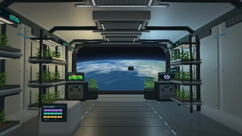 <strong>Orbital Habitat</strong></a> &nbsp;&nbsp;&nbsp;&nbsp;&nbsp;&nbsp;&nbsp;&nbsp;&nbsp;&nbsp;&nbsp;&nbsp;&nbsp;&nbsp;&nbsp;&nbsp;&nbsp;&nbsp;&nbsp;&nbsp;&nbsp;&nbsp;&nbsp;&nbsp;&nbsp;&nbsp;&nbsp;&nbsp;&nbsp;&nbsp;&nbsp;&nbsp;&nbsp;&nbsp;&nbsp;&nbsp;&nbsp;&nbsp;&nbsp;&nbsp;&nbsp;&nbsp;&nbsp;&nbsp;&nbsp;&nbsp;&nbsp;&nbsp;&nbsp;&nbsp;&nbsp;&nbsp;&nbsp;&nbsp;&nbsp;&nbsp;&nbsp;&nbsp;&nbsp;&nbsp;&nbsp;&nbsp;&nbsp;&nbsp;&nbsp;&nbsp;&nbsp;&nbsp;&nbsp;&nbsp;&nbsp;&nbsp;&nbsp;&nbsp;&nbsp;&nbsp;&nbsp;&nbsp;&nbsp;&nbsp;</td>
<td align="center" valign="top" width="260"><a href="library/scenes/wind-atlas.ru.md">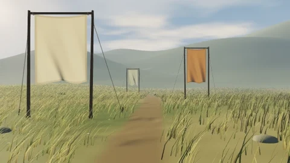 <strong>Wind Atlas</strong></a> &nbsp;&nbsp;&nbsp;&nbsp;&nbsp;&nbsp;&nbsp;&nbsp;&nbsp;&nbsp;&nbsp;&nbsp;&nbsp;&nbsp;&nbsp;&nbsp;&nbsp;&nbsp;&nbsp;&nbsp;&nbsp;&nbsp;&nbsp;&nbsp;&nbsp;&nbsp;&nbsp;&nbsp;&nbsp;&nbsp;&nbsp;&nbsp;&nbsp;&nbsp;&nbsp;&nbsp;&nbsp;&nbsp;&nbsp;&nbsp;&nbsp;&nbsp;&nbsp;&nbsp;&nbsp;&nbsp;&nbsp;&nbsp;&nbsp;&nbsp;&nbsp;&nbsp;&nbsp;&nbsp;&nbsp;&nbsp;&nbsp;&nbsp;&nbsp;&nbsp;&nbsp;&nbsp;&nbsp;&nbsp;&nbsp;&nbsp;&nbsp;&nbsp;&nbsp;&nbsp;&nbsp;&nbsp;&nbsp;&nbsp;&nbsp;&nbsp;&nbsp;&nbsp;&nbsp;&nbsp;</td>
</tr>
</table>

[Полный каталог →](library/README.ru.md)

## Библиотека AURS / AURP

Добавляйте в Aureon пользовательские визуальные сцены и отдельные проекции.

[Каталог AURS →](library/README.ru.md)

| Пакет | Что добавляет | Где импортировать |
| --- | --- | --- |
| **AURS** | Пользовательскую визуальную сцену | [Settings → Visuals → Import scene](docs/tutorials/19_Import_AURS_Scene.ru.md) |
| **AURP** | Пользовательскую проекцию | [Settings → Tray](docs/tutorials/20_Tray_Mini_Player.ru.md) |

**[Открыть библиотеку AURS / AURP →](library/README.ru.md)**

## Проверенные системы

| System | CPU / ОЗУ | GPU | ОС / окружение | Результат |
| --- | --- | --- | --- | --- |
| HP OMEN | i5-7300HQ / 12 ГБ | GTX 1050 · 2 ГБ | Windows 11 IoT Enterprise LTSC 24H2 · 26100.9550 | Проверено; до 60 FPS |
| MSI Evo E13 Flip | i7-1185G7 / 16 ГБ | Iris Xe | Windows 11 25H2 · 26200.9457 | Проверено; до 60 FPS |
| Настольный ПК | i5-13600KF / 32 ГБ | RTX 3070 · 8 ГБ | **Windows 11 26H2 · 26300.9711** | **Тесты пройдены**; 60+ FPS |
| Linux · VM | — | VMware SVGA3D | Mint 22.3 Cinnamon / X11 · x86_64 | Проверено |
| macOS · VM | Intel x86_64 | — | macOS · виртуальная машина | Проверено |
| iMac · реальное устройство | Intel Core i3 · 4 ядра · 3,6 ГГц / ОЗУ — | Radeon Pro 555X | macOS · Intel | Все проверенные AURS-темы отображаются корректно |

Начните с **Auto** и калибровки конкретной сцены. [Полные требования и замеры по сценам →](SYSTEM_REQUIREMENTS.ru.md)

## Проверенные медиаформаты

**Ранее на Windows проверено 79 образцов: 55 видео и 24 аудио.** Для Linux/macOS аналогичная матрица пока не заявлена.

| Видеоконтейнер | Проверенные видеокодеки |
| --- | --- |
| **MP4 / M4V** | H.264, HEVC, AV1, MPEG-4 Part 2, VP9; M4V проверен с H.264 |
| **MKV** | H.264, HEVC, AV1, VP9, FFV1 |
| **WebM** | VP8, VP9, AV1 |
| **MOV** | H.264, ProRes, DNxHR, QuickTime Animation |
| **AVI** | MPEG-4 / Xvid, MSMPEG4v3, MJPEG, HuffYUV |
| **WMV / ASF** | WMV1, WMV2 |
| **MPEG / MPG** | MPEG-1, MPEG-2 |
| **TS / M2TS** | TS: H.264, HEVC, MPEG-2; M2TS: H.264 |

| Аудиофайл | Проверенные аудиокодеки |
| --- | --- |
| **MP3** | MP3 CBR / VBR |
| **FLAC** | FLAC 16 / 24-bit, до 192 кГц в проверенных образцах |
| **WAV** | PCM 16 / 24-bit, float32, PCM 5.1, MP3, IMA ADPCM |
| **M4A / AAC** | M4A: AAC-LC, ALAC, Opus; AAC: AAC-LC в ADTS |
| **OGG / OPUS** | OGG: Vorbis, FLAC; OPUS: Opus |

В составе соответствующих видеоконтейнеров также проверены: **AC3 / EAC3, DTS core, TrueHD, WMA2 и MP2**.

Среди проверенных 10-bit вариантов — H.264 High 10, HEVC Main 10, AV1 и VP9. Результаты относятся к конкретным сочетаниям кодека и контейнера.

**[Подробности и результаты аудита →](docs/media-formats.ru.md)**

## Первые шаги

1. Откройте очередь стрелкой справа, нажмите **+ FILES** и выберите музыку или видео.
2. Нажмите на трек в очереди, чтобы запустить воспроизведение.
3. Нажмите название сцены в плеере и выберите визуальный фон.
4. Нажмите **F11**, чтобы развернуть сцену на весь экран. Повторное нажатие вернёт плеер в окно.

<strong>Показать, как добавить музыку</strong>

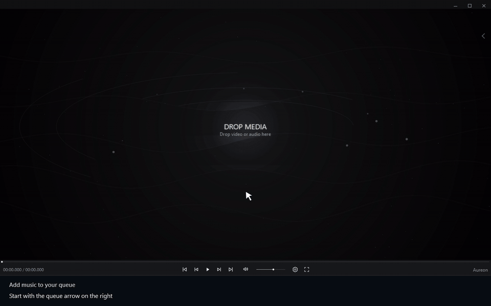

[Пошаговая инструкция](docs/tutorials/01_Add_Music.ru.md)

<strong>Показать, как выбрать сцену</strong>

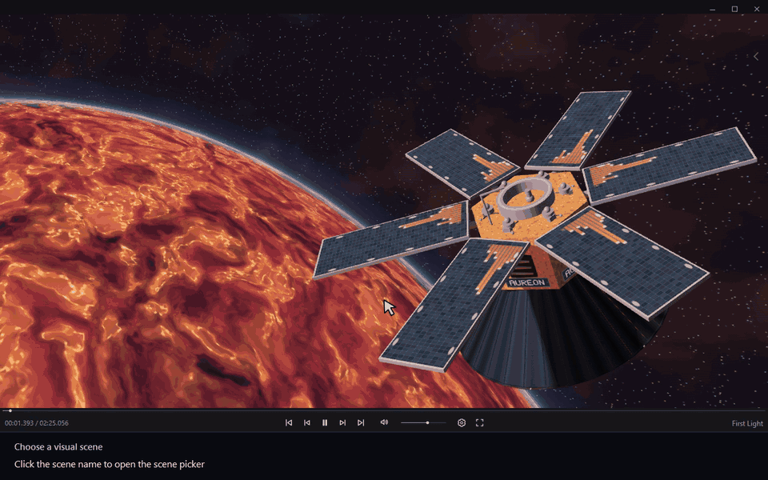

[Пошаговая инструкция](docs/tutorials/03_Choose_Scene.ru.md)

## Руководство пользователя

В руководстве — **14 разделов** с короткими записями настоящего интерфейса.

**Перетаскивание файлов:** добавьте музыку из Проводника; видео перетаскивайте **именно в очередь**. В смешанной очереди кнопка **«Показать видео сверху»** выводит видео в начало списка, сохраняя порядок воспроизведения.

| Хочу… | Инструкция |
| --- | --- |
| Добавить музыку или видео | [Музыка](docs/tutorials/01_Add_Music.ru.md) · [Видео](docs/tutorials/15_Play_Video.ru.md) |
| Организовать музыку | [Очередь и поиск](docs/tutorials/08_Queue_And_Search.ru.md) · [Плейлисты](docs/tutorials/22_Save_And_Import_Playlists.ru.md) |
| Выбрать визуальную сцену | [Scene Picker](docs/tutorials/03_Choose_Scene.ru.md) · [Сцена до воспроизведения](docs/tutorials/12_Idle_Scenes.ru.md) |
| Настроить графику | [Visual quality, Advanced и Calibrate Auto](docs/tutorials/26_Visual_Quality.ru.md) |
| Изменить оформление | [Цвета](docs/tutorials/02_Interface_Themes.ru.md) · [Стиль интерфейса](docs/tutorials/13_Interface_Style.ru.md) |
| Включить трей и проекции | [Режим трея](docs/tutorials/20_Tray_Mini_Player.ru.md) |
| Добавить собственную сцену | [Импорт AURS](docs/tutorials/19_Import_AURS_Scene.ru.md) |

**[Открыть руководство пользователя →](docs/user-guide.ru.md)**

## Частые вопросы

<strong>Aureon бесплатный?</strong>

Да. Приложением можно пользоваться бесплатно. Донаты добровольны.

<strong>В Aureon есть стриминговый каталог музыки?</strong>

Нет. Плеер воспроизводит ваши локальные файлы. Добавьте музыку или видео с компьютера в очередь.

<strong>Можно установить пользовательские сцены?</strong>

Да. Сцены **.aurs** импортируются из настроек Visuals, проекции **.aurp** — из настроек Tray.

<strong>Aureon запоминает воспроизведение при закрытии?</strong>

Восстановление сессии возвращает трек, очередь и позицию. Сохранение позиции регулируется через **Settings → Playback → Resume Playback**.

## Powered by FFmpeg / ffprobe

Aureon использует **[FFmpeg](https://ffmpeg.org/)** для обработки медиа и аудиоанализа, а **[ffprobe](https://ffmpeg.org/ffprobe.html)** — для информации о потоках. Спасибо участникам проекта FFmpeg.

## Обратная связь и поддержка

- [Новости в Twitter / X — @aureonsatellite](https://x.com/aureonsatellite).
- [Сообщить об ошибке](https://github.com/operfivenine/aureonsatellite/issues): укажите версии Aureon и Windows, шаги воспроизведения и приложите подходящий скриншот или лог.
- [Поддержать проект на Boosty](https://boosty.to/oper59).
- [Написать автору](mailto:aureonsatellite@gmail.com).

---

<strong>Ваша музыка. Своя орбита.</strong> Aureon — Your personal music satellite.

