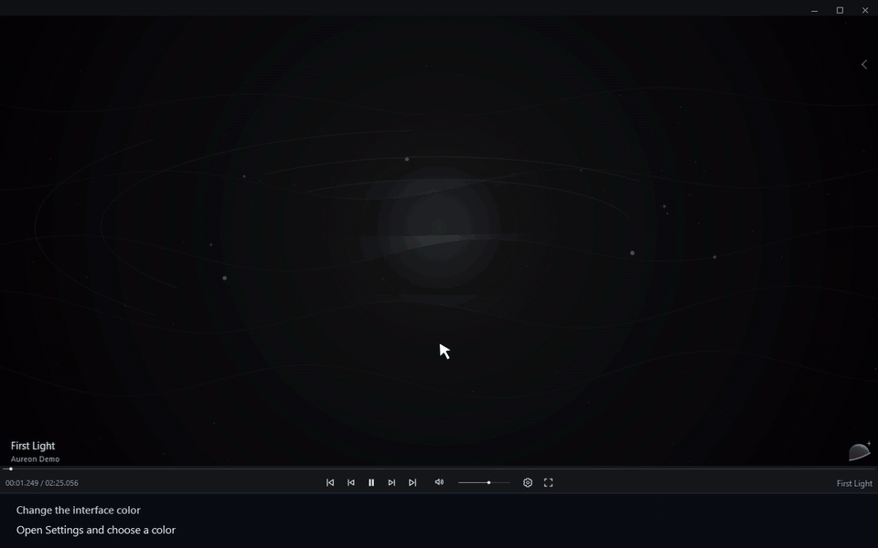

# Изменить цвет интерфейса

[← Руководство](../user-guide.ru.md) · [English](./02_Interface_Themes.md)

1. Откройте **Settings**.
2. Выберите **Appearance → Color**.
3. Выберите цвет.
4. Выбранный цвет применяется к интерфейсу.

