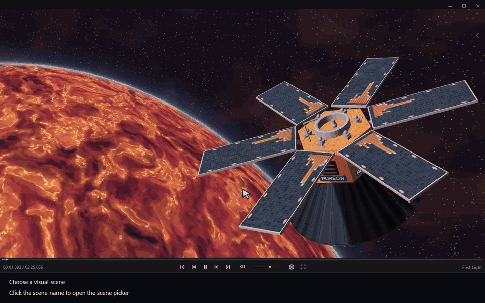

# Выбрать визуальную сцену

[← Руководство](../user-guide.ru.md) · [English](./03_Choose_Scene.md)

1. Нажмите название сцены в плеере, чтобы открыть **Scene Picker**.
2. Выберите сцену.

**Scene Picker отображается только при наличии трека в очереди.** Сцену также можно сменить в **Settings → Visuals**.

Чтобы выбрать фон до воспроизведения, откройте [Выбрать сцену до начала воспроизведения](12_Idle_Scenes.ru.md).

