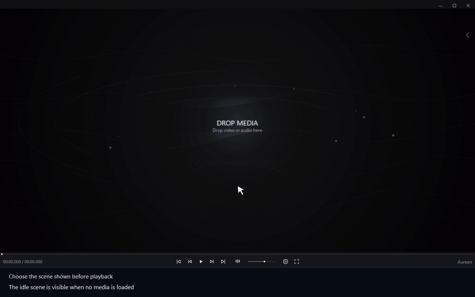

# Выбрать сцену до начала воспроизведения

[← Руководство](../user-guide.ru.md) · [English](./12_Idle_Scenes.md)

1. Откройте **Settings → Visuals**.
2. В **Idle visual** выберите сцену.

Выбранная сцена отображается до начала воспроизведения, когда медиафайл ещё не загружен.

