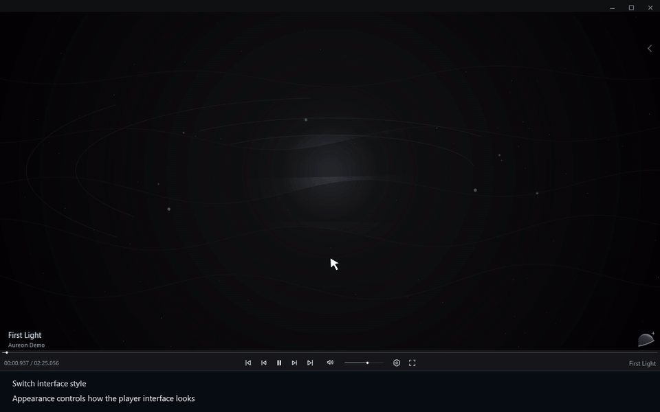

# Switch interface style

[← User guide](../user-guide.md) · [Русский](./13_Interface_Style.ru.md)

1. Appearance controls how the player interface looks.
2. Open Settings.
3. Choose Appearance.
4. Open Interface.
5. Choose Transparent Glass.
6. Return to the player.
7. The controls now use the floating Glass dock.

