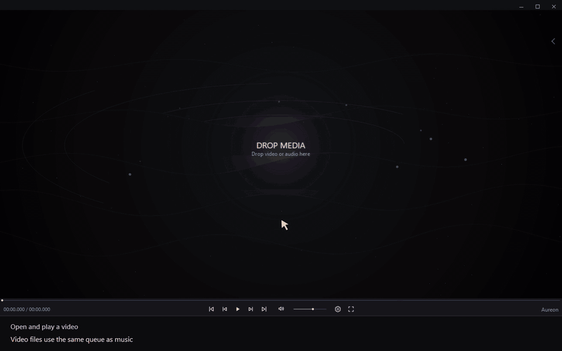

# Open and play a video

[← User guide](../user-guide.md) · [Русский](./15_Play_Video.ru.md)

1. Open the queue and add a video with **+ FILES**, or drag it from File Explorer **directly into the queue**.
2. Select the video in the queue.

**Video DnD works when the file is dropped into the queue.**

When the queue contains both music and video, use the **Show videos first** button in the queue panel to display videos at the top. This changes the queue view; the playback order stays the same.

