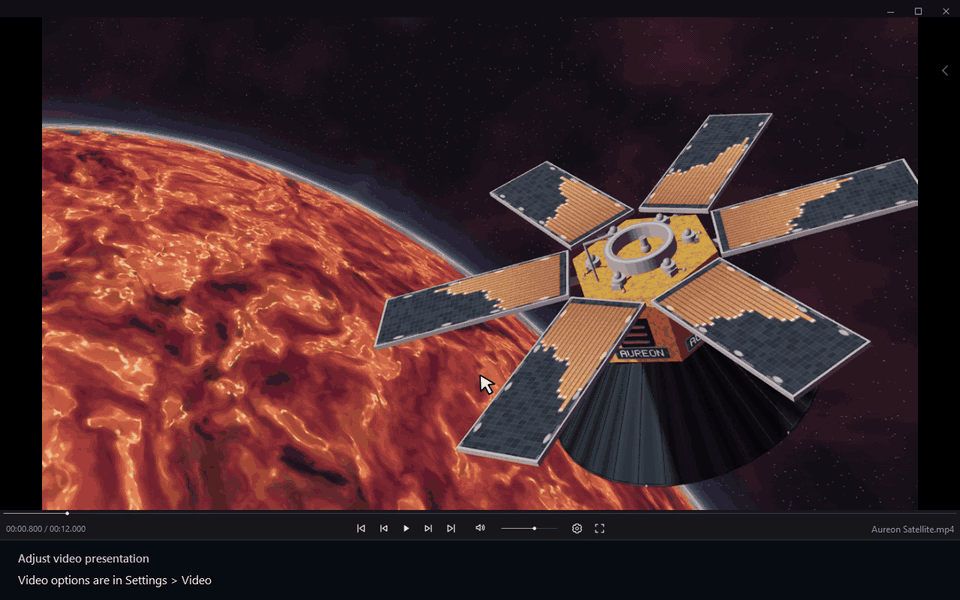

# Adjust video presentation

[← User guide](../user-guide.md) · [Русский](./17_Video_Zoom_And_Aspect.ru.md)

1. Video options are in Settings > Video.
2. Open Settings.
3. Choose Video.
4. Enable the Video zoom control.
5. Turn Video zoom on.
6. Choose an aspect ratio.
7. Choose 4:3.
8. Return to the player.
9. The video uses the selected aspect ratio.
10. Open Video zoom.
11. Drag to magnify the video.
12. Click the percentage button to return to the original zoom.
13. Reset video zoom to 100%.

