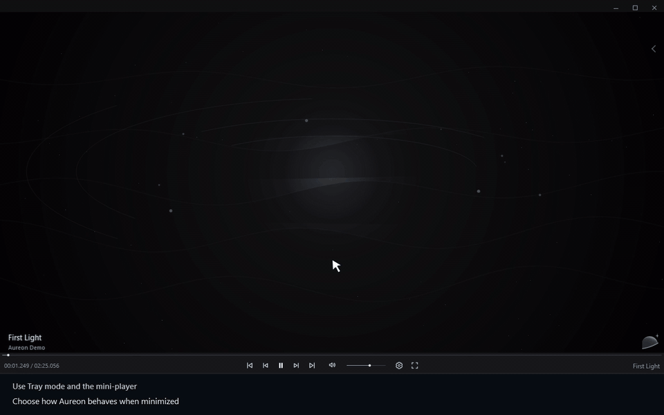
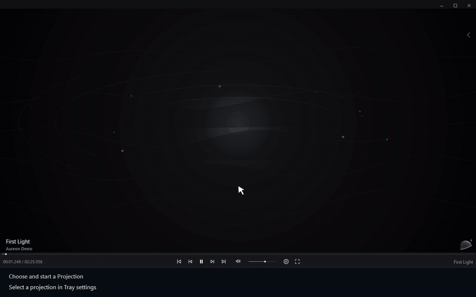

# Использовать режим трея

[← Руководство](../user-guide.ru.md) · [English](./20_Tray_Mini_Player.md)

## Трей и мини-плеер

1. Откройте **Settings → Tray** и включите **Tray mode**.
2. Включите **Minimize to tray** и сверните Aureon.
3. Нажмите правой кнопкой на значок Aureon в трее, чтобы открыть мини-плеер.
4. Управляйте воспроизведением из мини-плеера или восстановите основное окно.

## Проекции

1. Выберите проекцию в **Settings → Tray → Projection**.
2. Откройте мини-плеер в трее и нажмите кнопку **Projection**, чтобы запустить выбранную проекцию.
3. Повторное нажатие остановит проекцию.

