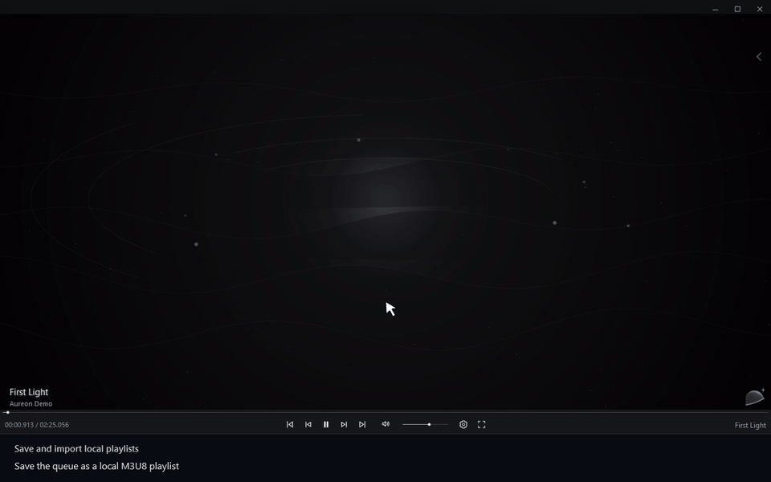

# Сохранить и импортировать плейлист

[← Руководство](../user-guide.ru.md) · [English](./22_Save_And_Import_Playlists.md)

В очереди SAVE… сохраняет порядок в M3U/M3U8. IMPORT… добавляет треки из локального плейлиста.

