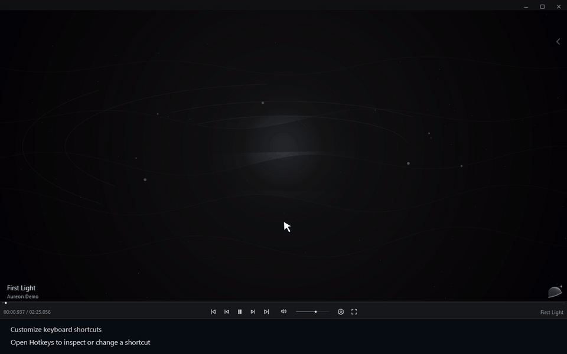

# Customize keyboard shortcuts

[← User guide](../user-guide.md) · [Русский](./23_Keyboard_Shortcuts.ru.md)

1. Open Hotkeys to inspect or change a shortcut.
2. Open Settings.
3. Choose Hotkeys.
4. Click the Play / Pause shortcut to record a new key.
5. Ctrl+Shift+P is now assigned to Play / Pause.
6. Right-click the shortcut to restore its default.
7. The default shortcut is restored.

