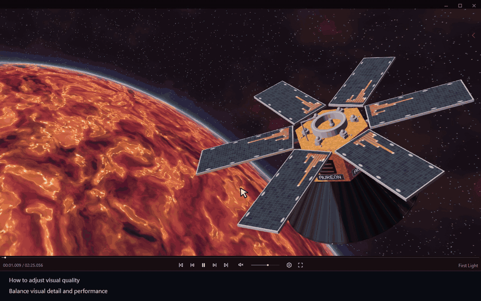

# How to adjust visual quality

[← User guide](../user-guide.md) · [Русский](./26_Visual_Quality.ru.md)

Open **Settings → Visuals → Visual quality** and choose a quality level.

- **Advanced** — manually adjust render resolution, detail and effects.
- **Calibrate Auto** — tests the current scene on your hardware and selects quality for **Auto**. Wait for it to finish and keep **Visual quality → Auto** selected. Manual Advanced settings stay in effect.

[Video MP4](../../assets/readme/tutorials/26_Visual_Quality.mp4)
