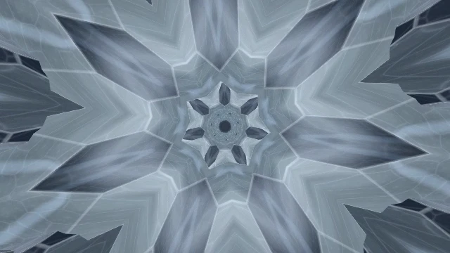
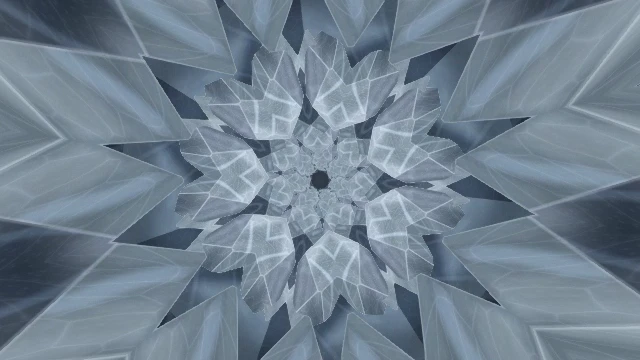
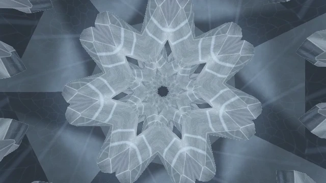
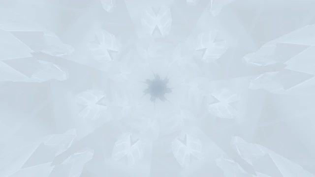
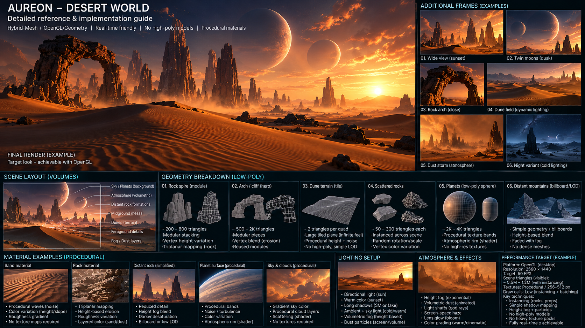
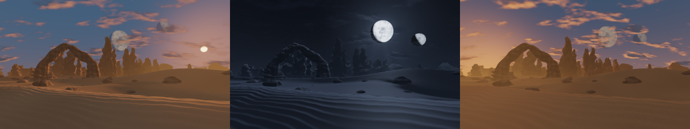

# For developers

[← Aureon](../README.md) · [Русский](author-skill.ru.md)

## AURS Author Skill 0.7.0 · Early Beta

<p align="center"></p>

AURS Author helps Codex design, edit, check and package `.aurs` scenes for Aureon. This is an early beta with partial creative testing. The bundled SDK targets **Aureon 0.24.5 v420**.

[Overview and quick start](skill/README.md) · [Configuration](skill/configuration.md) · [Technical reference](skill/technical-reference.md)

<details>
<summary><strong>Inside the Skill ZIP</strong></summary>

~~~text
aureon-aurs-author/
    ARTISTIC_REFINEMENT_CHANGELOG_RU.md
    ARTISTIC_REFINEMENT_V062_CHANGELOG_RU.md
    CODEX_START_HERE_RU.md
    README.md
    SKILL.md
    SOURCE_LOCK.json
    STAGE_A_CREATIVE_DIRECTION_CHANGELOG_RU.md
    STAGE_B_PRODUCTION_INTELLIGENCE_CHANGELOG_RU.md
    STAGE_C_MOTION_MUSIC_INTELLIGENCE_CHANGELOG_RU.md
    STAGE_D_MULTI_KEYFRAME_ENGINE_CHANGELOG_RU.md
    STAGE_E_ENGINEERING_SMOKE.json
    STAGE_E_INTEGRATION_REPORT_RU.md
    USER_GUIDE_RU.md
    agents/
    api/
    assets/
    references/
    scripts/
    sdk/
    templates/
    tests/
    trials/
~~~

</details>

### Prism Reverie · iterative authoring case study

Prism Reverie evolved through six iterations guided by creative feedback. [Development case study](skill/prism-reverie.md)

<p><a href="../assets/readme/prism-reverie/frame-1.webp"></a> <a href="../assets/readme/prism-reverie/frame-2.webp"></a> <a href="../assets/readme/prism-reverie/frame-3.webp"></a> <a href="../assets/readme/prism-reverie/frame-4.webp"></a></p>

Frames from scene 0.6.0 rendered in Aureon using test audio signals. [Scene and animated preview →](scenes/prism-reverie.md)

## AURS API 1.1

The technical contract for AURS packages, renderers, shaders and music signals.

[API reference](api/README.md) · [Authoring recommendations](api/docs/authoring-recommendations.md) · [Download documentation ZIP](https://github.com/operfivenine/aureonsatellite/releases/download/v0.24.5-v420/Aureon-AURS-API-1.1-v399-Documentation.zip)

<details>
<summary><strong>Inside the API archive</strong></summary>

The AURS 1.1 contract, EN/RU documentation and machine-readable references for features, fields, shader functions and audio channels.

```text
./
    API_RELEASE.json
    README.md
    README.ru.md
    windows-v399.md
    windows-v399.ru.md
docs/
    authoring-recommendations.md
    authoring-recommendations.ru.md
    cameras.md
    cameras.ru.md
    changes.md
    changes.ru.md
    contract.md
    contract.ru.md
    getting-started.md
    getting-started.ru.md
    glsl-symbols.md
    glsl-symbols.ru.md
    limits-and-qa.md
    limits-and-qa.ru.md
    mesh-hybrid.md
    mesh-hybrid.ru.md
    package.md
    package.ru.md
    portability.md
    portability.ru.md
    reactive.md
    reactive.ru.md
    release-checklist.md
    release-checklist.ru.md
    render-graph.md
    render-graph.ru.md
    scene-fields.md
    scene-fields.ru.md
    stability.md
    stability.ru.md
    standard-library.md
    standard-library.ru.md
    track-inputs.md
    track-inputs.ru.md
    troubleshooting.md
    troubleshooting.ru.md
reference/
    FEATURE_REGISTRY.json
    STANDARD_LIBRARY_SYMBOLS.json
    UNIFORMS_AND_CHANNELS.json
windows-reference/
    API_RELEASE.json
    AURS_SCENE_CURVE_EXP01_RU.md
    CAMERAS_RU.md
    FEATURE_REGISTRY.json
    HOST_SHADER_HELPERS.json
    HYBRID_FIX01_RU.md
    SCHEMA_FIELDS.json
    STANDARD_LIBRARY_SYMBOLS.json
    UNIFORMS_AND_CHANNELS.json
```

</details>

### Desert World · API example

From a visual brief to a working Aureon scene. The reference sets the composition, lighting and character of the terrain. In the Desert World package, Hybrid geometry shapes the dunes, arch and rock formations, while the background shader draws the sky and celestial bodies.

<p align="center"><a href="../assets/readme/desert-world-reference.png"></a></p>

**Reference.** Visual target and scene breakdown. Select the image to view it at full size.

<p align="center"></p>

**Result in Aureon.** Frames from the same scene at different times of day.

| What changes | How it works |
| --- | --- |
| Time of day | The sun completes its cycle in three minutes of scene time. Its elevation gradually changes the sky and terrain lighting. The moons and stars become visible at night. |
| Weather conditions | Wind shifts layers of procedural clouds and dust patterns above the surface. Visibility and the feel of the weather change within the same landscape. |
| Atmosphere | Haze builds up with distance and softens the far rock formations. Its color follows the lighting from warm sunset to cool night. |

[Open the scene and watch the animation →](scenes/desert-world.md)
