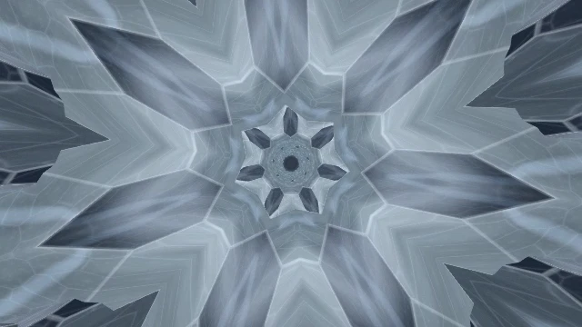
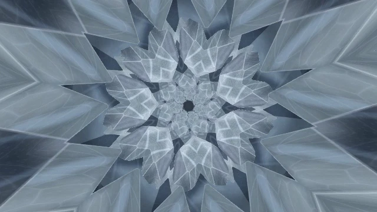
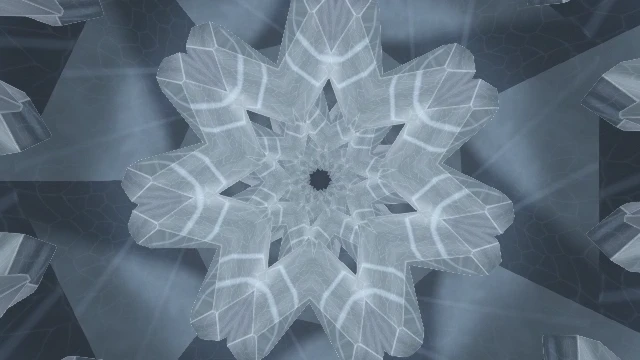
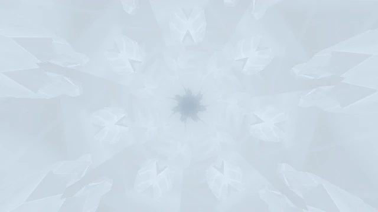
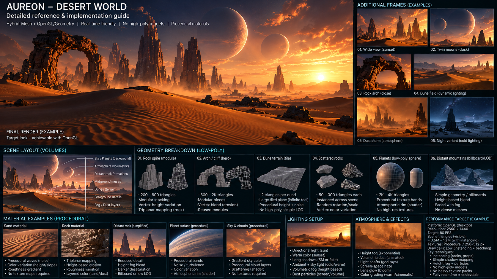
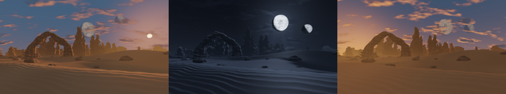

# Для разработчиков

[← Aureon](../README.ru.md) · [English](author-skill.md)

## AURS Author Skill 0.7.0 · Early Beta

<p align="center"></p>

AURS Author помогает Codex проектировать, редактировать, проверять и упаковывать сцены `.aurs` для Aureon. Это ранняя бета. Художественные испытания завершены частично. Встроенный SDK рассчитан на **Aureon 0.24.5 v420**.

[Обзор и быстрый старт](skill/README.ru.md) · [Конфигурация](skill/configuration.ru.md) · [Технический справочник](skill/technical-reference.ru.md)

<details>
<summary><strong>Состав ZIP со Skill</strong></summary>

~~~text
aureon-aurs-author/
    ARTISTIC_REFINEMENT_CHANGELOG_RU.md
    ARTISTIC_REFINEMENT_V062_CHANGELOG_RU.md
    CODEX_START_HERE_RU.md
    README.md
    SKILL.md
    SOURCE_LOCK.json
    STAGE_A_CREATIVE_DIRECTION_CHANGELOG_RU.md
    STAGE_B_PRODUCTION_INTELLIGENCE_CHANGELOG_RU.md
    STAGE_C_MOTION_MUSIC_INTELLIGENCE_CHANGELOG_RU.md
    STAGE_D_MULTI_KEYFRAME_ENGINE_CHANGELOG_RU.md
    STAGE_E_ENGINEERING_SMOKE.json
    STAGE_E_INTEGRATION_REPORT_RU.md
    USER_GUIDE_RU.md
    agents/
    api/
    assets/
    references/
    scripts/
    sdk/
    templates/
    tests/
    trials/
~~~

</details>

### Prism Reverie · пример итеративной разработки

Prism Reverie прошла шесть итераций с авторской обратной связью. [Разбор разработки](skill/prism-reverie.ru.md)

<p><a href="../assets/readme/prism-reverie/frame-1.webp"></a> <a href="../assets/readme/prism-reverie/frame-2.webp"></a> <a href="../assets/readme/prism-reverie/frame-3.webp"></a> <a href="../assets/readme/prism-reverie/frame-4.webp"></a></p>

Кадры сцены 0.6.0 из Aureon. Для превью использованы тестовые аудиосигналы. [Сцена и анимированное превью →](scenes/prism-reverie.ru.md)

## AURS API 1.1

Технический контракт для AURS-пакетов, рендереров, шейдеров и музыкальных сигналов.

[Справочник API](api/README.ru.md) · [Рекомендации](api/docs/authoring-recommendations.ru.md) · [Скачать ZIP с документацией](https://github.com/operfivenine/aureonsatellite/releases/download/v0.24.5-v420/Aureon-AURS-API-1.1-v399-Documentation.zip)

<details>
<summary><strong>Что внутри справочника API</strong></summary>

Контракт AURS 1.1, документация EN/RU и машинные справочники возможностей, полей, шейдерных функций и аудиоканалов.

```text
./
    API_RELEASE.json
    README.md
    README.ru.md
    windows-v399.md
    windows-v399.ru.md
docs/
    authoring-recommendations.md
    authoring-recommendations.ru.md
    cameras.md
    cameras.ru.md
    changes.md
    changes.ru.md
    contract.md
    contract.ru.md
    getting-started.md
    getting-started.ru.md
    glsl-symbols.md
    glsl-symbols.ru.md
    limits-and-qa.md
    limits-and-qa.ru.md
    mesh-hybrid.md
    mesh-hybrid.ru.md
    package.md
    package.ru.md
    portability.md
    portability.ru.md
    reactive.md
    reactive.ru.md
    release-checklist.md
    release-checklist.ru.md
    render-graph.md
    render-graph.ru.md
    scene-fields.md
    scene-fields.ru.md
    stability.md
    stability.ru.md
    standard-library.md
    standard-library.ru.md
    track-inputs.md
    track-inputs.ru.md
    troubleshooting.md
    troubleshooting.ru.md
reference/
    FEATURE_REGISTRY.json
    STANDARD_LIBRARY_SYMBOLS.json
    UNIFORMS_AND_CHANNELS.json
windows-reference/
    API_RELEASE.json
    AURS_SCENE_CURVE_EXP01_RU.md
    CAMERAS_RU.md
    FEATURE_REGISTRY.json
    HOST_SHADER_HELPERS.json
    HYBRID_FIX01_RU.md
    SCHEMA_FIELDS.json
    STANDARD_LIBRARY_SYMBOLS.json
    UNIFORMS_AND_CHANNELS.json
```

</details>

### Desert World · пример API

От визуального задания до работающей сцены Aureon. Референс задаёт композицию, свет и характер местности. В пакете Desert World дюны, арка и скалы собраны как геометрия Hybrid, а небо и небесные тела рисуются шейдером фона.

<p align="center"><a href="../assets/readme/desert-world-reference.png"></a></p>

**Референс.** Визуальная цель и разбор слоёв сцены. Нажмите на изображение, чтобы открыть его целиком.

<p align="center"></p>

**Результат в Aureon.** Кадры одной сцены в разные фазы суток.

| Что меняется | Как это работает |
| --- | --- |
| Время суток | Полный цикл занимает три минуты по часам сцены. Высота солнца плавно меняет цвет неба и освещение рельефа. В ночной фазе видны луны и звёзды. |
| Погодные условия | Ветер сдвигает слои процедурных облаков и рисунок пыли над поверхностью. Так меняется видимость и ощущение погоды в одном ландшафте. |
| Атмосфера | Дымка усиливается с расстоянием, скрывая дальние скалы. Её цвет меняется вместе с освещением от тёплого закатного до холодного ночного. |

[Открыть сцену и посмотреть анимацию →](scenes/desert-world.ru.md)
