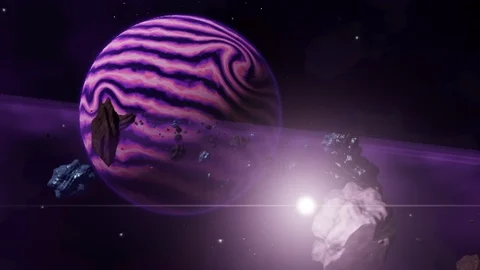

# Asteroid Belt

[← Каталог сцен](../README.ru.md) · [English](asteroid-belt.md)

Дополнительная сцена Aureon, устанавливается отдельным пакетом **.aurs**.

Пакет **1.0.1** · `Aureon-Asteroid-Belt-1.0.1.aurs`

**[Скачать .aurs](https://github.com/operfivenine/aureonsatellite/releases/download/aurs-library-v1/Aureon-Asteroid-Belt-1.0.1.aurs)**

## Установка

Импортируйте `.aurs` через **Settings → Visuals → Import scene**, затем выберите тему в Scene Picker.

[Как импортировать сцену →](../../docs/tutorials/19_Import_AURS_Scene.ru.md)
