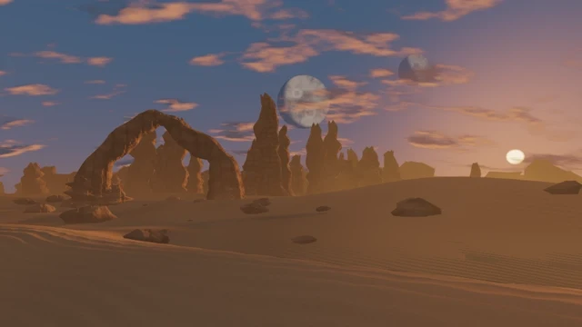

# Desert World

[← Scene catalog](../README.md) · [Русский](desert-world.ru.md)

A desert landscape with a changing sky, drifting dust and a day–night cycle.

Package **0.1.0** · `Aureon-Desert-World-0.1.0.aurs`

**[Download .aurs](https://github.com/operfivenine/aureonsatellite/releases/download/v0.24.5-v420/Aureon-Desert-World-0.1.0.aurs)**

## Installation

Import `.aurs` in **Settings → Visuals → Import scene**, then select the scene in Scene Picker.

[Scene import guide →](../../docs/tutorials/19_Import_AURS_Scene.md)
