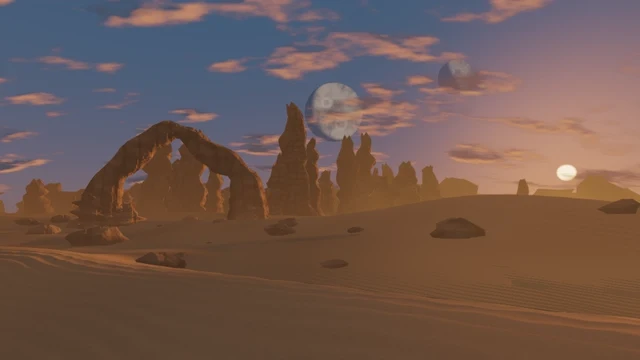

# Desert World

[← Каталог сцен](../README.ru.md) · [English](desert-world.md)

Пустынный пейзаж с меняющимся небом, пылью и циклом дня и ночи.

Пакет **0.1.0** · `Aureon-Desert-World-0.1.0.aurs`

**[Скачать .aurs](https://github.com/operfivenine/aureonsatellite/releases/download/v0.24.5-v420/Aureon-Desert-World-0.1.0.aurs)**

## Установка

Импортируйте `.aurs` через **Settings → Visuals → Import scene**, затем выберите тему в Scene Picker.

[Как импортировать сцену →](../../docs/tutorials/19_Import_AURS_Scene.ru.md)
