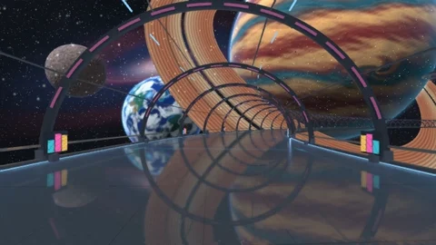

# Neon Concourse

[← Каталог сцен](../README.ru.md) · [English](neon-concourse.md)

Дополнительная сцена Aureon, устанавливается отдельным пакетом **.aurs**.

Пакет **2.3.2** · `Aureon-Neon-Concourse-2.3.2.aurs`

**[Скачать .aurs](https://github.com/operfivenine/aureonsatellite/releases/download/aurs-library-v1/Aureon-Neon-Concourse-2.3.2.aurs)**

## Установка

Импортируйте `.aurs` через **Settings → Visuals → Import scene**, затем выберите тему в Scene Picker.

[Как импортировать сцену →](../../docs/tutorials/19_Import_AURS_Scene.ru.md)
