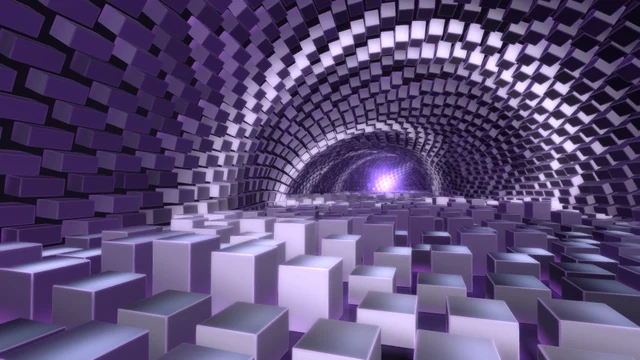

# Phase Lattice

[← Scene catalog](../README.md) · [Русский](phase-lattice.ru.md)

A music-reactive scene built around a shifting geometric lattice.

Package **0.6.0** · `Aureon-Phase-Lattice-0.6.0.aurs`

**[Download .aurs](https://github.com/operfivenine/aureonsatellite/releases/download/v0.24.5-v420/Aureon-Phase-Lattice-0.6.0.aurs)**

## Installation

Import `.aurs` in **Settings → Visuals → Import scene**, then select the scene in Scene Picker.

[Scene import guide →](../../docs/tutorials/19_Import_AURS_Scene.md)
