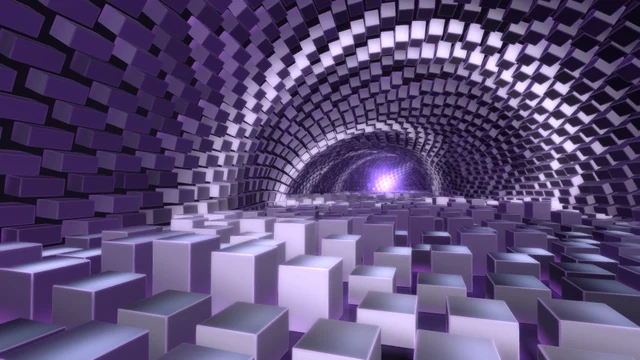

# Phase Lattice

[← Каталог сцен](../README.ru.md) · [English](phase-lattice.md)

Музыкально-реактивная сцена с меняющейся геометрической решёткой.

Пакет **0.6.0** · `Aureon-Phase-Lattice-0.6.0.aurs`

**[Скачать .aurs](https://github.com/operfivenine/aureonsatellite/releases/download/v0.24.5-v420/Aureon-Phase-Lattice-0.6.0.aurs)**

## Установка

Импортируйте `.aurs` через **Settings → Visuals → Import scene**, затем выберите тему в Scene Picker.

[Как импортировать сцену →](../../docs/tutorials/19_Import_AURS_Scene.ru.md)
