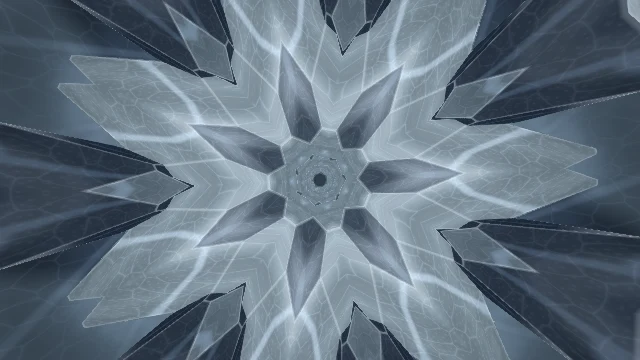

# Prism Reverie

[← Scene catalog](../README.md) · [Русский](prism-reverie.ru.md)

A psychedelic scene with continuous inward flight, layered crystals and music-driven impulses.

Package **0.6.0** · `Aureon-Prism-Reverie-0.6.0.aurs`

**[Download .aurs](https://github.com/operfivenine/aureonsatellite/releases/download/v0.24.5-v420/Aureon-Prism-Reverie-0.6.0.aurs)**

## Installation

Import `.aurs` in **Settings → Visuals → Import scene**, then select the scene in Scene Picker.

[Scene import guide →](../../docs/tutorials/19_Import_AURS_Scene.md)

[Development case study →](../skill/prism-reverie.md)
