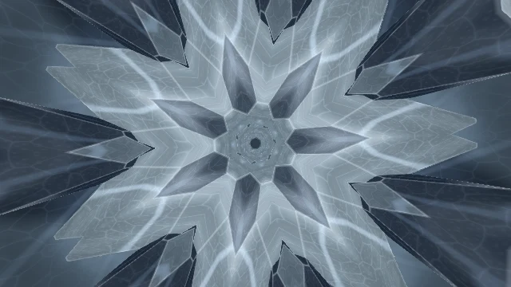

# Prism Reverie

[← Каталог сцен](../README.ru.md) · [English](prism-reverie.md)

Психоделическая сцена с непрерывным полётом к центру, слоями кристаллов и музыкальными импульсами.

Пакет **0.6.0** · `Aureon-Prism-Reverie-0.6.0.aurs`

**[Скачать .aurs](https://github.com/operfivenine/aureonsatellite/releases/download/v0.24.5-v420/Aureon-Prism-Reverie-0.6.0.aurs)**

## Установка

Импортируйте `.aurs` через **Settings → Visuals → Import scene**, затем выберите тему в Scene Picker.

[Как импортировать сцену →](../../docs/tutorials/19_Import_AURS_Scene.ru.md)

[История разработки →](../skill/prism-reverie.ru.md)
