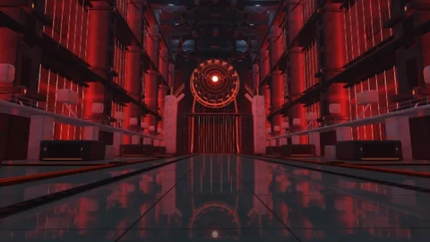

# Red Chamber

[← Scene catalog](../README.md) · [Русский](red-chamber.ru.md)

An additional Aureon scene, installed as a separate **.aurs** package.

Package **1.0.3** · `Aureon-Red-Chamber-1.0.3.aurs`

**[Download .aurs](https://github.com/operfivenine/aureonsatellite/releases/download/aurs-library-v1/Aureon-Red-Chamber-1.0.3.aurs)**

## Installation

Import `.aurs` in **Settings → Visuals → Import scene**, then select the scene in Scene Picker.

[Scene import guide →](../../docs/tutorials/19_Import_AURS_Scene.md)
